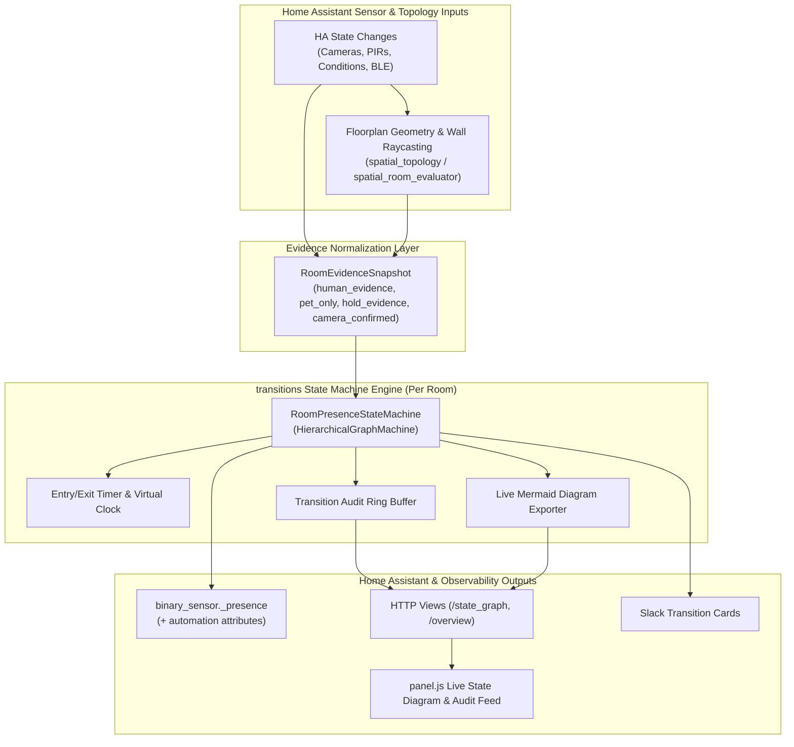
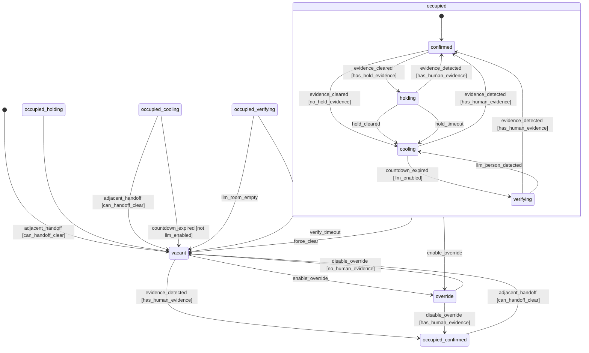
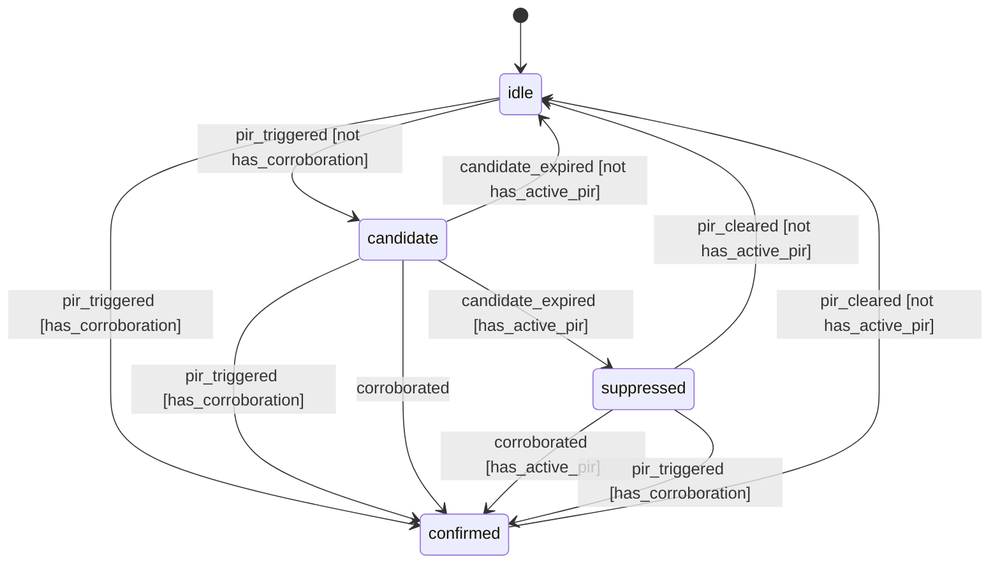

# Architecture: Presence Detection Designer

This document defines the reworked architecture, module boundaries, `transitions` state-flow model, and bounded-liveness guarantees for **Presence Detection Designer (`ha-presence-detection-designer`)**.

---

## High-Level System Architecture



---

## Room State Machine Flow (`HierarchicalGraphMachine`)



## PIR Validation State Machine (`PIRValidationStateMachine` — Per Room)



- **Any-One-Of Corroborators (`PIR-02`)**: `camera` (Frigate person/subzone), `trajectory` (adjacent room/path/door), `ble` (Bermuda room/adjacent), `time_history` (2+ sensors or 2+ fast-PIR pulses in `60s`).
- **Cooldown Reliability Weighting (`PIR-03`)**: `sensor_reliability.py` computes `weight_from_cooldown(cooldown_sec)` and tempers Bayesian log-odds (`odds^w`) so Ecobee (`300s`/`1800s`) and battery camera PIR (`family_room_ring_motion`) remain supporting evidence only.

---

## Module Boundaries (`<= 500 LOC` per module)

```text
custom_components/presence_detection_designer/
├── state_machine.py          # HierarchicalGraphMachine model, TransitionRecord, Mermaid export
├── pir_validation.py         # Separate GraphMachine PIR candidate gate (10s window, 4 corroborators)
├── sensor_reliability.py     # Cooldown-based Bayesian weighting & hardware reliability catalog
├── evidence_snapshot.py      # RoomEvidenceSnapshot normalization (spatial + triggers + optional Bayesian/conditions)
├── coordinator.py            # HA event subscriptions, timer scheduling, coordinator lifecycle
├── coordinator_dispatch.py   # Transition event bus, Slack attribution, adjacent handoff dispatch
├── binary_sensor.py          # binary_sensor.<room>_presence + automation attributes
├── spatial_topology.py       # Preserved 2D floorplan & doorway-occluded raycasting
├── spatial_room_evaluator.py # Preserved positive/negative-space & human/pet classification
├── coordinator_helpers.py    # Evidence snapshot normalization (direct vs. hold-only spatial boundaries)
├── causal_context.py         # Manual vs. auto actuator tracking strictly bounded from trigger_entities
└── static/panel.js           # Floorplan studio, live state diagram view, timeline & replay UI

tests/harness/ & scripts/
├── virtual_ha.py             # Deterministic VirtualClock + InMemoryHass wiring real coordinators & sensors
├── scenario_runner.py        # Declarative JSON/YAML multi-room scenario executor
├── ha_playback.py            # HA Recorder SQLite, History JSON, and PDD .storage playback engine
├── feedback_envelope.py      # 6-part diagnostic failure envelope & action/log taps
└── replay_scenario.py        # CLI runner for synthetic scenarios and real HA data playback
```

---

## Core Design Guarantees

1. **Bounded Liveness (`GUARD-01`)**: No state can hold occupancy indefinitely; `holding`, `cooling`, and `verifying` each arm an entry timer and cancel it on exit.
2. **Pet Exclusion (`GUARD-02`)**: Pet-only spatial detections (`pet_present=True`, `human_present=False`) set `human_evidence_active=False` and never drive `vacant -> occupied`.
3. **Decoupled Headcount (`GUARD-03`)**: Whole-house headcount tracking cannot mutate or clear room occupancy state machines.
4. **Deterministic Replay & Clock-Anchor Parity (`REPLAY-01`, `REPLAY-02`, `STATE-07`)**: The exact same `RoomPresenceStateMachine` drives live Home Assistant timers, `replay_engine.py`, and `VirtualHAHarness` via clock-anchored timestamps (`_virtual_now` + `_virtual_wall_base`) so scheduled callbacks never observe stale virtual timestamps.
5. **Strict Trigger vs. Sustaining Hold Boundary (`GUARD-06`, `GUARD-07`)**: Non-trigger sustaining actuators (`sustaining_conditions`) and hold-only spatial exclusions (`negative_space` / `blind_pocket` without `positive_drivers`) feed only `has_hold_evidence` (`occupied_holding`, bounded by `max_hold_timeout`) and cannot enter `_active_triggers` or inject manual entry pulses.
