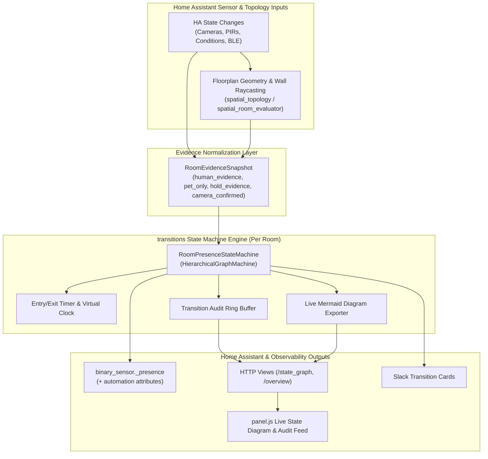
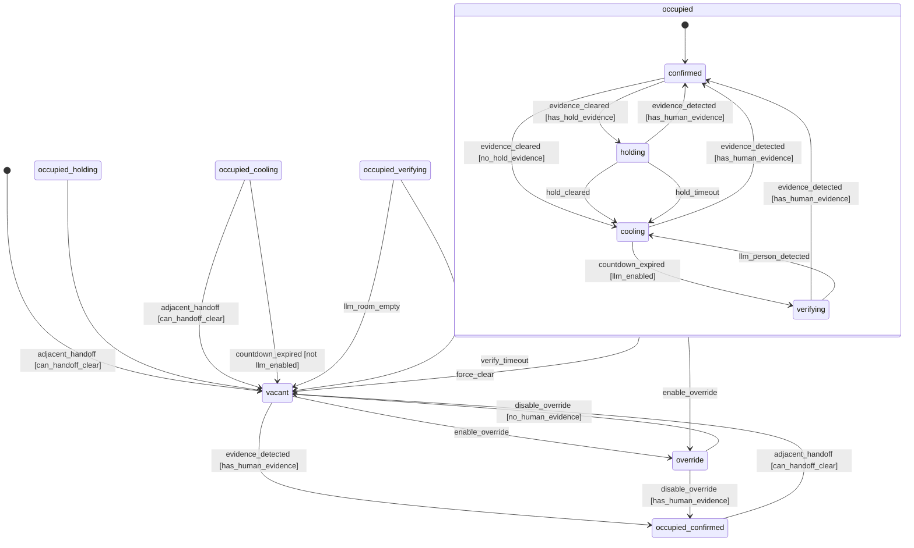

# Architecture: Presence Detection Designer

This document defines the reworked architecture, module boundaries, `transitions` state-flow model, and bounded-liveness guarantees for **Presence Detection Designer (`ha-presence-detection-designer`)**.

---

## High-Level System Architecture



---

## Room State Machine Flow (`HierarchicalGraphMachine`)



*(Phase 2 will insert the `candidate` PIR validation state between `vacant` and `occupied_confirmed` once the `transitions` foundation is verified.)*

---

## Module Boundaries (`<= 500 LOC` per module)

```text
custom_components/presence_detection_designer/
├── state_machine.py          # HierarchicalGraphMachine model, TransitionRecord, Mermaid export
├── evidence_snapshot.py      # RoomEvidenceSnapshot normalization (spatial + triggers + optional Bayesian/conditions)
├── coordinator.py            # HA event subscriptions, timer scheduling, coordinator lifecycle
├── coordinator_dispatch.py   # Transition event bus, Slack attribution, adjacent handoff dispatch
├── binary_sensor.py          # binary_sensor.<room>_presence + automation attributes
├── spatial_topology.py       # Preserved 2D floorplan & doorway-occluded raycasting
├── spatial_room_evaluator.py # Preserved positive/negative-space & human/pet classification
└── static/panel.js           # Floorplan studio, live state diagram view, timeline & replay UI
```

---

## Core Design Guarantees

1. **Bounded Liveness (`GUARD-01`)**: No state can hold occupancy indefinitely; `holding`, `cooling`, and `verifying` each arm an entry timer and cancel it on exit.
2. **Pet Exclusion (`GUARD-02`)**: Pet-only spatial detections (`pet_present=True`, `human_present=False`) set `human_evidence_active=False` and never drive `vacant -> occupied`.
3. **Decoupled Headcount (`GUARD-03`)**: Whole-house headcount tracking cannot mutate or clear room occupancy state machines.
4. **Deterministic Replay Parity (`REPLAY-01`)**: The exact same `RoomPresenceStateMachine` drives live Home Assistant timers and `replay_engine.py` virtual clock steps.
