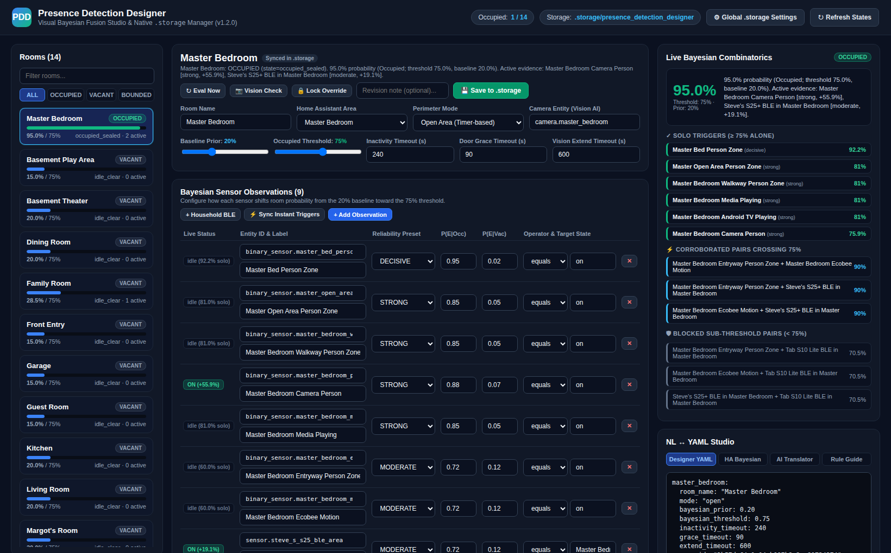
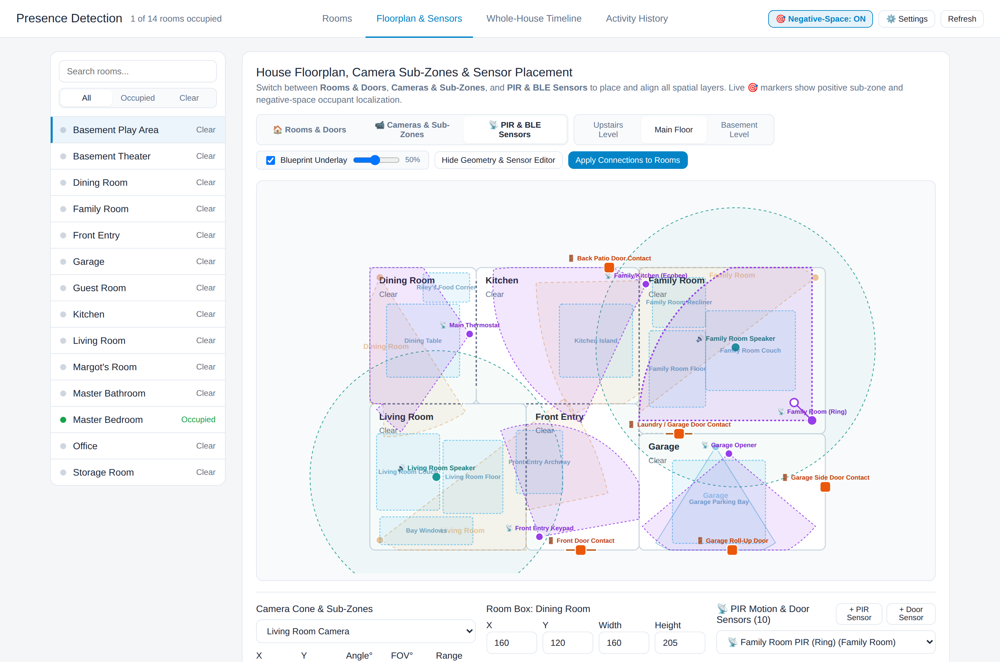
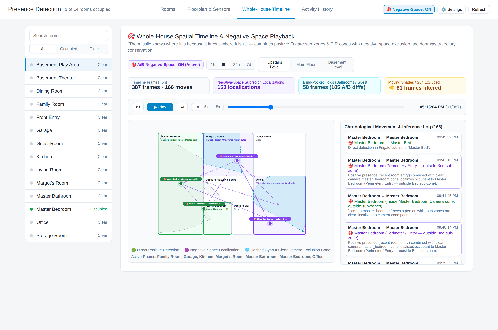
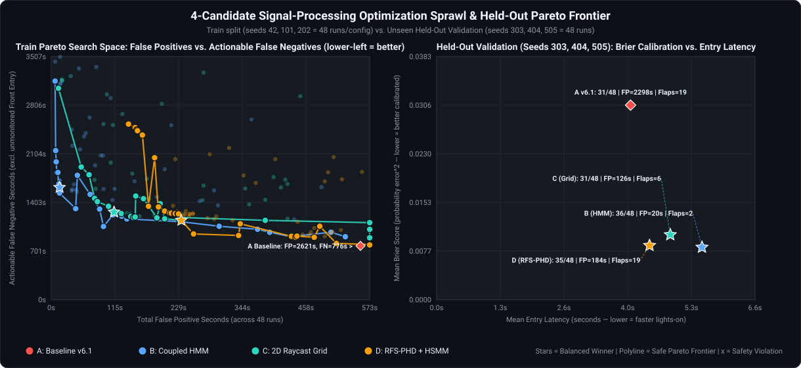

<div align="center">


# Presence Detection Designer (`ha-presence-detection-designer`)

**3D Floorplan-Aware Multi-Modal Presence Engine for Home Assistant** — uniting a **Coupled Continuous-Time Log-Odds HMM**, **2D+Floor Extended Kalman Filter (EKF)**, **Wall-Clipped Negative-Space Geometry**, **Sustaining Conditions**, and **Confidence-Gated Lighting Control**.

[](https://github.com/spelech/ha-presence-detection-designer/actions/workflows/ci.yml)
[](https://github.com/spelech/ha-presence-detection-designer/actions/workflows/validate.yml)
[](https://spelech.github.io/ha-presence-detection-designer/)
[](https://hacs.xyz/)
[](https://www.python.org/)
[](LICENSE)

[](https://my.home-assistant.io/redirect/hacs_repository/?owner=spelech&repository=ha-presence-detection-designer&category=integration)

</div>

---

## Why Presence Detection Designer?

Most Home Assistant presence setups fail in predictable ways because each sensor class is blind to the house's physical layout:

- **Stationary Occupancy Drops:** Watching TV on the couch, working at a desk, or reading in bed? PIR motion clears and lights shut off on you.
- **Multi-Story BLE Bleed:** 2.4 GHz BLE passes through wood subfloors more easily than through a human body, causing standalone BLE trackers (Bermuda / ESPresense) to ping-pong between stacked floors.
- **Hallway PIR Spillover:** A motion sensor inside a bedroom or family room sees people walking past the open doorway and falsely triggers lights.
- **Pets, Sunlight & Manual Overrides:** Dogs trigger non-pet-immune PIRs, moving shades trigger cameras, and turning off a light manually shouldn't immediately get overridden 10 seconds later.

**Presence Detection Designer (PDD)** solves these together by modeling the **entire house as a coupled 3D spatial graph**:

| Layer | Engine | What It Solves |
| :--- | :--- | :--- |
| **Layer 1: Spatial Geometry** | Wall-clipped camera & PIR cones, raycast spillover matrix, pet/shade guards | Quantifies hallway PIR spillover (`0–100%`), blocks pet/sunlight false triggers, and applies negative-space decay when a camera clearly sees an empty room. |
| **Layer 2A: 2D+Floor EKF** | Continuous `[x, y, vx, vy]` + hysteretic floor selector (`ekf_floor_stability_v2`) | Fuses live Bermuda per-proxy BLE ranges with Mahalanobis-gated camera/PIR hits without proxy-count bias or cross-floor teleports. |
| **Layer 2B: Coupled HMM** | Continuous-time log-odds `HouseHMMEngine` (`coupled_hmm`) | Fuses cameras, PIRs, door contacts, Ecobee thermal sensors, EKF room integrals, and sustaining conditions (TV/HDMI, UPS watts, shower humidity) across connected rooms. |
| **Layer 3: Output & Intent** | Room state machine + `meets_lighting_threshold` + `manual_off_suppressed` | Exposes clean `binary_sensor.<room>_presence` entities with spillover-aware lighting confidence gates and automatic manual-off suppression. |

> **Full Documentation:** Read the complete setup guide, lighting automation recipes, and mathematical reference on **[GitHub Pages](https://spelech.github.io/ha-presence-detection-designer/)**.

---

## Visual Tour

<p align="center">
  
  
</p>
<p align="center">
  
  
</p>

---

## Quick Start

### 1. Install via HACS
1. Click the **Open HACS Repository** badge above (or add `https://github.com/spelech/ha-presence-detection-designer` as a custom **Integration** repository in HACS).
2. Download **Presence Detection Designer** and restart Home Assistant.
3. Go to **Settings → Devices & Services → Add Integration → Presence Detection Designer** to add your rooms.

### 2. Map Your Floorplan & Sensors
Open **Presence Detection** in the Home Assistant sidebar:
1. Draw or import your rooms across floors (Basement, Main Floor, Upstairs) and connect doorways/stairs.
2. Place your **Frigate camera sub-zones**, **PIR sensors** (with FOV/range presets), **door contacts**, and **BLE proxies**.
3. Configure **Sustaining Conditions** for stationary rooms (e.g., LG webOS / Android TV `media_player`, workstation UPS wattage, shower humidity derivative).
4. Use **Playback** to scrub historical sensor timelines and verify room transitions before wiring lights.

### 3. Wire Confidence-Gated Lighting Automations
PDD exposes two attributes specifically designed for rock-solid lighting automations:
- **`meets_lighting_threshold`** (`true`/`false`): Automatically enforces higher confidence in high-spillover rooms (`61.4%` in enclosed rooms, `72%` in medium-spillover rooms, `80%` in open-plan/high-spillover rooms).
- **`manual_off_suppressed`** (`true`/`false`): Automatically pauses re-triggering when you turn a room's lights off manually while still inside.

```yaml
alias: "Office - Presence Entry Lighting"
mode: single
triggers:
  - trigger: occupancy.detected
    target:
      entity_id: binary_sensor.office_presence
conditions:
  - condition: state
    entity_id:
      - light.office_ceiling
      - light.office_lamp
    state: "off"
  - condition: state
    entity_id: binary_sensor.office_presence
    attribute: meets_lighting_threshold
    state: true
  - condition: state
    entity_id: binary_sensor.office_presence
    attribute: manual_off_suppressed
    state: false
  - condition: state
    entity_id: sun.sun
    state: "below_horizon"
actions:
  - action: scene.turn_on
    target:
      entity_id: scene.office_evening
```

> See the **[Lighting Automations Guide](docs/lighting-automations.md)** for the companion **anti-reset auto-off** pattern with UI-tunable timeout sliders.

---

## Entities Created per Room

| Entity | Domain | Purpose |
| :--- | :--- | :--- |
| `binary_sensor.<room>_presence` | `binary_sensor` (`occupancy`) | Primary occupancy entity with `bayesian_probability_pct`, `meets_lighting_threshold`, `recommended_lighting_threshold_pct`, `manual_off_suppressed`, `confidence_tier`, `hmm_active_drivers`, `ekf_track`, and `natural_language_explanation`. |
| `sensor.<room>_occupancy_probability` | `sensor` (`%`) | Live `0.0–100.0%` continuous occupancy probability for dashboards, history graphs, and diagnostics. |
| `button.<room>_verify_presence` | `button` | Triggers an immediate camera snapshot + Vision LLM verification check. |
| `switch.<room>_presence_override` | `switch` | Locks room presence `on` indefinitely (guests, parties, cleaning). |

---

## Documentation Map

- **[Getting Started](docs/getting-started.md)** — Installation, room setup, floorplan calibration, Frigate & Bermuda integration.
- **UI Guide:**
  - **[Room Editor](docs/ui/room-editor.md)** — Setup, Rules & NL↔YAML Studio, State Machine, and Diagnostics tabs.
  - **[Floorplan Studio](docs/ui/floorplan-studio.md)** — Multi-floor canvas, blueprint underlay, tool modes, camera alignment, doorway occlusion, and live EKF overlay.
  - **[Timeline Playback](docs/ui/timeline-playback.md)** — Whole-house synchronized historical scrubbing and driver auditing.
  - **[Replay & Statistics](docs/ui/replay-and-statistics.md)** — What-if parameter simulation and long-term sensor analytics.
  - **[Global Settings](docs/ui/global-settings.md)** — Inference engine, feature toggles, BLE trackers, Vision LLM, and Slack alerts.
- **[Lighting Automations](docs/lighting-automations.md)** — Entry lighting, anti-reset auto-off with tunable helpers, and spillover thresholds.
- **[How It Works](docs/how-it-works.md)** — Plain-English guide to the Coupled HMM, 2D+Floor EKF (`ekf_floor_stability_v2`), negative space, and Playback.
- **[Configuration & Reference](docs/reference.md)** — Full entity attributes, services, global feature toggles, and troubleshooting.
- **[Architecture & Mathematical Reference](docs/ARCHITECTURE_AND_MATH.md)** — Full equations, state machine transitions, and EKF/HMM math.
- **[Signal-Processing Optimization Report](docs/SIGNAL_PROCESSING_OPTIMIZATION_REPORT.md)** — Empirical benchmark comparing 4 presence architectures across 15,000+ scenario runs.

---

## Development & Quality Gates

```bash
# Verify version sync across pyproject.toml and manifest.json
python3 scripts/verify_release.py --ci

# Lint and format check
uv run ruff check .
uv run ruff format --check .

# Run test suite
uv run pytest -q
```

---

## License

Distributed under the [MIT License](LICENSE). Copyright &copy; 2026 Steven T. Pelech.
