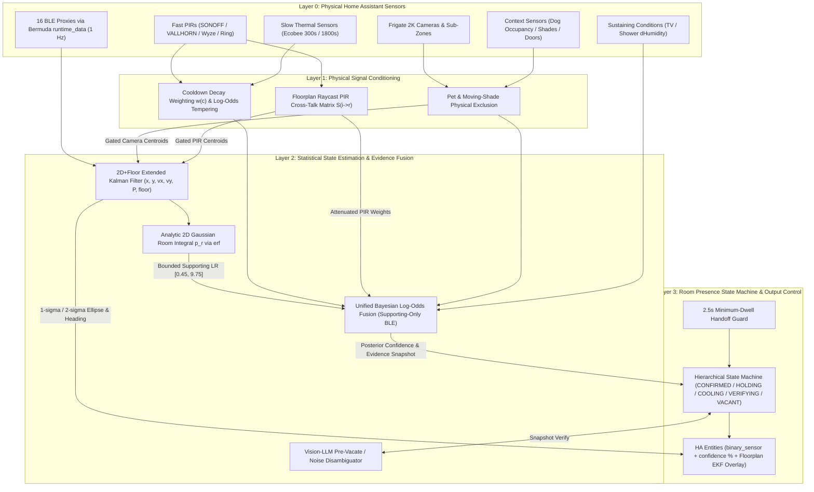
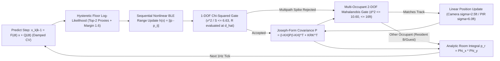
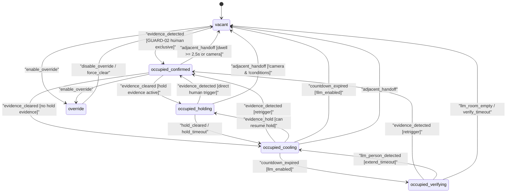

# Presence Detection Designer — Architecture, Signal Processing & Mathematical Reference

> **Design Objective:** Rather than forcing brittle binary yes/no decisions from noisy residential sensors—or layering ad-hoc overrides that fight one another—Presence Detection Designer (**PDD**) models indoor occupancy as a **continuous statistical estimation and output-based control problem**. Physical sensors are conditioned by their hardware dynamics and room geometry, fused via an **Extended Kalman Filter (EKF)** and **bounded Bayesian log-odds engine** into an explainable **0–100% occupancy confidence score**, and finally resolved into clean, chatter-free room states by a **hierarchical finite state machine**.

> **See also:** [Signal-Processing Optimization Sprawl & 4-Candidate Comparison Report](SIGNAL_PROCESSING_OPTIMIZATION_REPORT.md) — empirical head-to-head race (`244` configurations, `11,904` scenario runs across train and unseen held-out seeds) comparing Production v6.1 Baseline against Coupled Continuous-Time HMM, 2D Raycast Grid, and RFS-PHD + HSMM architectures.

---

## Table of Contents

1. [System Overview: 3-Layer Architecture](#1-system-overview-3-layer-architecture)
2. [Layer 1: Physical Signal Conditioning](#2-layer-1-physical-signal-conditioning)
   - [2.1 Cooldown Reliability Curve & Log-Odds Power Tempering](#21-cooldown-reliability-curve--log-odds-power-tempering)
   - [2.2 Geometric Raycast PIR Cross-Talk Matrix](#22-geometric-raycast-pir-cross-talk-matrix)
   - [2.3 Physical Pet Exclusion & Moving-Shade Suppression](#23-physical-pet-exclusion--moving-shade-suppression)
   - [2.4 Human-Exclusive Initiation Guard (GUARD-02)](#24-human-exclusive-initiation-guard-guard-02)
3. [Layer 2A: 2D + Floor Extended Kalman Filter (EKF)](#3-layer-2a-2d--floor-extended-kalman-filter-ekf)
   - [3.1 State Vector & Damped Constant-Velocity Dynamics](#31-state-vector--damped-constant-velocity-dynamics)
   - [3.2 Hysteretic Floor Log-Likelihood Estimator](#32-hysteretic-floor-log-likelihood-estimator)
   - [3.3 Nonlinear Multi-Proxy BLE Range Updates & Chi-Squared Gating](#33-nonlinear-multi-proxy-ble-range-updates--chi-squared-gating)
   - [3.4 Multi-Occupant Data Association (Mahalanobis Gating)](#34-multi-occupant-data-association-mahalanobis-gating)
   - [3.5 Analytic 2D Gaussian Room Integration](#35-analytic-2d-gaussian-room-integration)
   - [3.6 Zero-Entity-Spam Live Bermuda Integration](#36-zero-entity-spam-live-bermuda-integration)
4. [Layer 2B: Unified Bayesian Confidence Fusion & Vision-LLM Noise Disambiguation](#4-layer-2b-unified-bayesian-confidence-fusion--vision-llm-noise-disambiguation)
   - [4.1 Continuous EKF-to-Likelihood Mapping](#41-continuous-ekf-to-likelihood-mapping)
   - [4.2 Anti-Double-Counting Invariant & Negative-Space Conservation](#42-anti-double-counting-invariant--negative-space-conservation)
   - [4.3 Asymmetric Negative Evidence (BAYES-04)](#43-asymmetric-negative-evidence-bayes-04)
   - [4.4 Vision-LLM Pre-Vacate & Noise Tiebreaker](#44-vision-llm-pre-vacate--noise-tiebreaker)
5. [Layer 3: Room Presence State Machine & Hysteretic Output Control](#5-layer-3-room-presence-state-machine--hysteretic-output-control)
   - [5.1 Hierarchical State Diagram & Transition Table](#51-hierarchical-state-diagram--transition-table)
   - [5.2 Adjacent Handoff & Minimum-Dwell Safety Belt](#52-adjacent-handoff--minimum-dwell-safety-belt)
   - [5.3 Home Assistant Output Interface & Floorplan EKF Overlay](#53-home-assistant-output-interface--floorplan-ekf-overlay)
6. [Golden Benchmark Validation & Quantitative Results](#6-golden-benchmark-validation--quantitative-results)
7. [Tunable Parameter Reference](#7-tunable-parameter-reference)

---

## 1. System Overview: 3-Layer Architecture

PDD cleanly separates **physics & noise filtering** (Layer 1), **statistical estimation & fusion** (Layer 2), and **discrete output state control** (Layer 3). Each layer has one clear responsibility and never overrides or double-counts an upstream layer.

- **Interactive Studio (LAN):** http://preview.lan/m-pdd-arch/
- **Mermaid Live Editor:** [Open Architecture Diagram in mermaid.live](https://mermaid.live/edit#pako:eNp9VW1v2joU_itHSHdiWtMBXe9LdTUpTQJUDQQRSu_uOlUmMWAtsSPbAbJ1_33HDgWCpvElzsHPc57zmu-tRKS0dQOtZSa2yZpIDbPbJw74U-ViJUmxhrDz-akVkopK6NzAZF0plpAMhiKn4CrFlCZcQ0y5ElI9tb7UcPPz3BFC-5KtiKbQuweP5FQSBW8gLhfO_4LTJmByNzUAorQ5KmjH0Tjq9-E9zN0wHEbTMR4fq28UH1PGV28b6MCLEB1jJDBbU5mjyL0qaAeJWFAKV52OQmz3b3w2wbdhgODun-YAEyl2jCrYMAK3yFSmBGTJNcvpc0o0gXYXht-aBF409o37EvPBOIoDT_CUaSY4-p_N0W28FlvMYjosc4b_VGfyx3PEI0jTnT4q98UKoiQpC8KTypKQlJogfIH_HykoT5_4eem6h9J1T0oXsxXHx0Efim0omQahVSKyVGw5-DQhFTxStlprE9e2nbzFEoZi5URpqmBG84LKc5L_Zm54b6qZoc4iIxympEr2pQVPCqWcGcm-wohoyXYQt5nzUTZTMnJjQzGhGv2NxAZ9ODb-YyzBLslKhUH8PhG9QyJ6NxBrorFt61xo05sBvuXE5AIdBRuWUp5Q6DeJbZHu-8jU89_ZsNC7Rnc0hXuS5Rhin2UafbR3F1BdwAYfG3xOLmBprjeDG7gPcYxkLtaiQjHQ82FASpwokyshcrjDVkD9GRTP0vYilctm07qfAkPxwNmSoYpbjNDCD7WpQ8BBKotCSFM-J-JZZbq8qSYMzazOmbnu4AvOAHXmJDHZeQ9jwRQFnymSL9iqJFrI3-f76pDvq5s6GORTNqt1xkckWTNOMd1RqYtSm27UUmQNUf3YiBoyXBoSrx_r9Ypu49T176ajwEeRwyj078YDPHlRFNaneTC963_an13PHc-aYfuPQWiavXd5rWCEc5uXueNvaYYLjvBULJcwKIlMG6DoYWZkuRDgStBmUbQXjBNZPSs7tfAOEsGX-y76A1-PQ4ANBNGGyoxUv5xd3JngOB9t69cW3AtnFjNAxoJz2jTYmdujvKh5x-w1Y0ABtcHwGcvLU2uAOU332xk8agrBUlzNL8fblrpx3Y7xL--aGI0r2-G1yR738FtR2pk59iSEU_jcufxwfQH_XP51_cWw2d6uwRiD5TsxncpxNQ5hedBULyp1xvEa7anNrOxzmz3uiSdC4TQzLKh3LOfJfog5KdRaaOMKW7UmsB1lWQ8mPMC_NeUrBOZIvKwMEofteM3gsL0aeURY11FslRNs4t7-FGQZK5SRM6Qktcv3xSBbF9DKzcePpfhd_97Sa5rbL3xK5NfWD_yXlFrEFU_QqGVJ0VIW-FGjPiM4vPne_OMnnAJ09A)

### Module Map

| Layer | Core Modules | Responsibility |
| :--- | :--- | :--- |
| **Layer 1** | `sensor_reliability.py`, `spatial_topology.py`, `spatial_inference.py` | Cooldown curves, log-odds tempering, solid-wall FOV raycasting, PIR cross-talk matrix, pet & moving-shade exclusion |
| **Layer 2A** | `ble_kalman_tracker.py` | 2D+Floor EKF (`BLEKalmanTracker`, `HouseEKFManager`), Bermuda `runtime_data` reader, Mahalanobis gating, analytic `erf` room probabilities |
| **Layer 2B** | `bayesian_engine.py`, `coordinator_dispatch.py`, `spatial_room_evaluator.py`, `llm_verifier.py` | Continuous EKF + sensor Bayesian log-odds fusion, anti-double-counting, blind-pocket conservation, Vision-LLM verification |
| **Layer 3** | `state_machine.py`, `coordinator.py`, `binary_sensor.py`, `sensor.py`, `static/panel.js` | Hierarchical room state machine, minimum-dwell handoff guard, HA entity attributes, live floorplan EKF visualization |

---

## 2. Layer 1: Physical Signal Conditioning

### 2.1 Cooldown Reliability Curve & Log-Odds Power Tempering

Implemented in `custom_components/presence_detection_designer/sensor_reliability.py` (`weight_from_cooldown`, `apply_signal_weight`).

Different motion sensors hold their `on` state for vastly different hardware cooldowns after motion ceases (e.g., SONOFF SNZB-03PR2: `15s`, Ecobee SmartSensor motion: `300s`, Ecobee occupancy tail: `1800s`). Treating a stale 30-minute thermal tail with the same evidentiary weight as a fast 15-second PIR guarantees multi-minute false positives after room exit.

PDD computes a continuous, monotonic reliability weight $w \in [0.12,\, 1.0]$ from hardware cooldown $c$ (seconds) and battery power flag $b \in \{0, 1\}$:

$$w(c, b) = \operatorname{clip}_{[0.12,\,1.0]}\!\left( \frac{0.65^b}{1 + \dfrac{\max(0,\, c - 60)}{150}} \right)$$

| Sensor Class | Cooldown $c$ | Battery $b$ | Reliability Weight $w$ | Effective Behavior |
| :--- | :---: | :---: | :---: | :--- |
| Fast PIR (SONOFF SNZB-03PR2 / VALLHORN / Wyze V1) | $\le 60\text{s}$ | `0` | **`1.000`** | Full unattenuated Bayesian authority |
| Battery Camera PIR (Ring Stick Up) | $60\text{s}$ | `1` | **`0.650`** | Tempered supporting/corroborated weight |
| Ecobee SmartSensor Motion | $300\text{s}$ | `0` | **`0.385`** | Supporting context; cannot hold room occupied solo |
| Ecobee Occupancy Tail | $1800\text{s}$ | `0` | **`0.120`** | Minimal background tail (`+1–2%` lift) |

To temper any observation's baseline likelihoods $(p_T, p_F)$ without distorting calibration, PDD applies **log-odds power tempering**:

$$\text{odds}_T = \frac{p_T}{1 - p_T}, \qquad \text{odds}_F = \frac{p_F}{1 - p_F}$$

$$\text{odds}_{T,w} = \text{odds}_T^{\,w}, \qquad \text{odds}_{F,w} = \text{odds}_F^{\,w}$$

$$p_{T,w} = \frac{\text{odds}_{T,w}}{1 + \text{odds}_{T,w}}, \qquad p_{F,w} = \frac{\text{odds}_{F,w}}{1 + \text{odds}_{F,w}}$$

At $w = 1.0$, $(p_{T,w}, p_{F,w}) = (p_T, p_F)$ identically; as $w \to 0$, both smoothly contract toward uninformative $(0.50, 0.50)$ (likelihood ratio $\text{LR} = 1.0$). The same weight also tempers hybrid negative-space boosts in `spatial_room_evaluator.py`, preventing stale Ecobee cooldowns from generating phantom negative-space holds.

---

### 2.2 Geometric Raycast PIR Cross-Talk Matrix

Implemented in `spatial_topology.py` (`compute_pir_spillover_matrix`), cached per floorplan signature in `spatial_inference.py`, and applied in `bayesian_engine.py` & `coordinator_dispatch.py`.

In open-plan homes, wide-angle PIR cones physically bleed across room boundaries (e.g., `kitchen_motion_occupancy` overlaps `31%` into `Front Entry`; `dining_room_motion_occupancy` overlaps `20%` into `Living Room`). PDD samples a $10 \times 10$ spatial grid over every room polygon $r$ on floor $f$ and casts rays from each PIR sensor $i$ against `floor_wall_segments[f]`, yielding the exact geometric spillover matrix:

$$S_{i \to r} = \frac{1}{|G_r|} \sum_{\mathbf{q} \in G_r} \mathbb{1}\!\Big[\mathbf{q} \in \operatorname{Cone}(i) \;\land\; \neg\operatorname{Occluded}(\mathbf{p}_i, \mathbf{q}, \mathcal{W}_f)\Big]$$

Whenever a peer room $r \ne \operatorname{host}(i)$ is currently in `OCCUPIED_CONFIRMED` and $S_{i \to r} \ge 0.05$, sensor $i$'s active cross-talk fraction is:

$$s_i = \max_{r \in \mathcal{R}_{\text{confirmed}} \setminus \{\operatorname{host}(i)\}} S_{i \to r}$$

PDD attenuates sensor $i$'s Bayesian weight via the exact same `apply_signal_weight` operator:

$$w_{\text{ct}}(s_i) = \max\!\big(0.15,\; 1 - k_{\text{ct}}\,s_i\big), \qquad k_{\text{ct}} = 2.5$$

Furthermore, if $s_i \ge 0.08$ while the room is vacant and the attenuated Bayesian posterior falls below threshold, solo PIR initiation is suppressed (`spatial_crosstalk_attenuated_<pct>pct`). Because $S_{i \to r}$ is derived purely from floorplan geometry, physically shielding or ceiling-mounting a PIR immediately drives $S_{i \to r} \to 0$ and restores $w_{\text{ct}} = 1.0$ automatically.

---

### 2.3 Physical Pet Exclusion & Moving-Shade Suppression

Implemented in `spatial_inference.py`:
- **Pet Exclusion:** When a room's Frigate `dog_occupancy` sensor is active with no human camera detection in that room, uncorroborated PIR triggers in that room are placed in `pet_excluded_entities`, preventing a patrolling dog from occupying rooms (`0s` FP on `household_pet_patrol_main_floor`).
- **Moving-Shade Sunlight Transient Suppression:** Motorized window shades entering `opening`/`closing`/`moving` arm a settling window (`SHADE_SETTLE_WINDOW_SEC`). Static sunlit Frigate sub-zones flickering during shade travel without corroborating thermal PIR or entry motion are placed in `shade_sunlight_excluded_entities` (`0s` FP on `sunlit_shade_movement_false_camera_flicker`).

---

### 2.4 Human-Exclusive Initiation Guard (`GUARD-02`)

Implemented in `sensor_reliability.py` (`is_human_exclusive_initiator`) and `coordinator_helpers.py`:
- **Strict Initiation Rule:** Only person-coupled sensors (Frigate person detectors and validated human-exclusive PIRs) may transition a room from `VACANT -> OCCUPIED_CONFIRMED`.
- **Supporting-Only Classes:** BLE trackers, media players, power monitors, door contacts, environmental sensors (e.g., shower $\Delta\text{humidity}$), and pet detections can **never** solo-initiate room occupancy. BLE trackers are explicitly excluded from `allowed_set` in `coordinator_helpers.py` and never veto PIRs in other rooms.

---

## 3. Layer 2A: 2D + Floor Extended Kalman Filter (EKF)

Implemented in `custom_components/presence_detection_designer/ble_kalman_tracker.py` (`BLEKalmanTracker`, `HouseEKFManager`, `read_bermuda_proxy_ranges`).

- **Interactive Studio (LAN):** http://preview.lan/m-pdd-ekf/
- **Mermaid Live Editor:** [Open EKF Pipeline Diagram in mermaid.live](https://mermaid.live/edit#pako:eNplk9ty2jAQhl9lx1emjUmgUy4ypTOUQ04kuDbpTWmYraxgFVtyZDmFxnn3rgQxzMQ30qykb3f_f_3iMZVw7xy8x0z9ZSlqA9NoIYG-MBqPfi68UPNEMAOx4cU5bJbreh10oA8TPzEt2MBH-O52_gjzgicw_NFaeL92iMk0IsLltjRccyMYTDKlNEzVKpiKNc9EqlQC_lwVQRdCrTaClwS8Rb0SEjrt3gH1bTq-J1bMnyoujcAM7pTMhOSo7RlEKFcc7osEDYfU37SoxLouIIBiKeq64VwM5uMOgTrBaDaBYSqC-KlC6hEu7Ev_-aELpxDDlz702r1PJxABf8asosME0ECyTNEcyhrE8WxIuNsqMyKYMVYVKA10Hf0WU8xQqt-i3NMTohO5c9bunZ24Xe_xiBbOYtvkdNdWqEphhJJvXflDzLlGKMUqx363_fnRUKnhVbSP9Npnx7DrWUysa1XyIg0mSucwVM-oBUrGISR5_Kvg5rIV7paHOQl_E908zBvAOJoQYCAx21rvIqVyuJKGrzSpXyw1IcJULDfwwa1b9_AwOxAEX-0ENKPgAtbHg6Mu5Cw5cscGybABY7wg1RdebXt5f8FpXqBJIS5omiDifzjbP3C-NDq4NEcht32joGEpjd1cI1vbp9aE99dmJuUaGoN9O6PKnF5UvLSa11atg4kuYVP0WwXNFdrssXd8Y6Bz-Q_mYp-dlPNOwCOncxQJ_ZovHqXO3U-aoF57r3SKlVHxVjIKGl1xilRuRkYCyZ18H379D1aQKBU)

### 3.1 State Vector & Damped Constant-Velocity Dynamics

For each tracked BLE resident (e.g., `sensor.resident_a_phone_ble_area`), the filter maintains a continuous 4-state vector in floorplan coordinates (scale $s_{\text{px}} = 12.5\text{ px/ft}$), its $4 \times 4$ covariance $P_k$, and a discrete floor state $f_k \in \{\text{basement}, \text{main}, \text{upstairs}\}$:

$$\mathbf{x}_k = \begin{bmatrix} x_k \\ y_k \\ v_{x,k} \\ v_{y,k} \end{bmatrix}, \qquad P_k \in \mathbb{R}^{4 \times 4}$$

Unlike an aerospace constant-velocity model for aircraft, indoor humans start and stop abruptly inside bounded rooms. To prevent velocity coasting through walls when measurements pause, velocity decays exponentially with time constant $\tau_v = 2.5\text{s}$ ($\gamma = e^{-\Delta t / \tau_v}$) and speed is clamped to $v_{\max} = 10\text{ ft/s}$:

$$F(\Delta t) = \begin{bmatrix} 1 & 0 & \Delta t & 0 \\ 0 & 1 & 0 & \Delta t \\ 0 & 0 & \gamma & 0 \\ 0 & 0 & 0 & \gamma \end{bmatrix}, \qquad \hat{\mathbf{x}}_{k|k-1} = F(\Delta t)\,\hat{\mathbf{x}}_{k-1|k-1}$$

Process noise $Q(\Delta t)$ follows discrete white-noise human acceleration ($\sigma_a = 1.5\text{ ft/s}^2$, scaled by $s_{\text{px}}$):

$$Q(\Delta t) = \sigma_a^2 \begin{bmatrix} \frac{1}{4}\Delta t^4 & 0 & \frac{1}{2}\Delta t^3 & 0 \\ 0 & \frac{1}{4}\Delta t^4 & 0 & \frac{1}{2}\Delta t^3 \\ \frac{1}{2}\Delta t^3 & 0 & \Delta t^2 & 0 \\ 0 & \frac{1}{2}\Delta t^3 & 0 & \Delta t^2 \end{bmatrix}, \qquad P_{k|k-1} = F P_{k-1|k-1} F^T + Q(\Delta t)$$

Derived kinematic outputs:

$$\text{speed} = \frac{\sqrt{v_x^2 + v_y^2}}{s_{\text{px}}}, \qquad \theta_{\text{heading}} = \operatorname{atan2}(v_y, v_x) \bmod 360^\circ \quad (\text{when speed} \ge 0.35\text{ ft/s})$$

---

### 3.2 Hysteretic Floor Log-Likelihood Estimator

Cross-floor BLE bleed through wood/drywall floors is a major source of vertical false transitions. Rather than jumping floors on whichever single proxy had the highest instantaneous RSSI, `update_floor()` scores each floor $f$ using its top-2 closest active proxies plus any floor hint:

$$L_f(t) = 6.0 \sum_{j \in \text{top2}(f)} \frac{1}{\max(1.5,\; d_j)} + h_f(t)$$

Scores are smoothed via an exponential moving average ($\alpha = 0.45$):

$$\bar{L}_f(t) = \alpha\,L_f(t) + (1 - \alpha)\,\bar{L}_f(t - 1)$$

A competing floor $f^* \ne f_{k-1}$ only wins the transition when $\bar{L}_{f^*}(t) - \bar{L}_{f_{k-1}}(t) \ge 1.6$ (or a strong camera/PIR hint confirms $f^*$ when BLE is absent). On a floor transition, position covariance $P_{xx}, P_{yy}$ is inflated to $(12\text{ ft})^2$ and velocity is zeroed so proxies on the new floor acquire lock immediately.

---

### 3.3 Nonlinear Multi-Proxy BLE Range Updates & Chi-Squared Gating

At cold start, the EKF initializes via an inverse-distance-squared weighted centroid of the top-4 closest proxies on floor $f_k$:

$$\mathbf{p}_0 = \frac{\sum_i w_i \mathbf{p}_i}{\sum_i w_i}, \qquad w_i = \frac{1}{\max(1.5,\; d_i)^2}$$

Thereafter, each active proxy $i$ on floor $f_k$ (ordered closest-first for optimal linearization conditioning) applies a scalar nonlinear EKF range update:

$$h_i(\mathbf{x}) = \hat{d}_i = \sqrt{(x - x_i)^2 + (y - y_i)^2}, \qquad H_i = \frac{\partial h_i}{\partial \mathbf{x}} = \begin{bmatrix} \dfrac{x - x_i}{\hat{d}_i} & \dfrac{y - y_i}{\hat{d}_i} & 0 & 0 \end{bmatrix}$$

**Critical Detail — Predicted-Range Heteroscedastic Noise $R_i(\hat{d}_i)$:**  
Indoor BLE distance variance scales roughly linearly with range and packet age. Crucially, $\sigma_i$ is evaluated at the **predicted range $\hat{d}_i$** (never the raw noisy measurement $d_i$!), so a wild positive multipath spike (e.g., `+20 ft`) cannot self-inflate its own $R_i$ and slip past the outlier gate:

$$\sigma_i = \sigma_0 + \alpha_d\,\hat{d}_i + \alpha_{\text{age}}\,\Delta t_i \qquad (\sigma_0 = 2.2\text{ ft},\; \alpha_d = 0.16,\; \alpha_{\text{age}} = 0.35\text{ ft/s})$$

$$R_i = (\sigma_i\,s_{\text{px}})^2, \qquad \nu_i = d_{i,\text{px}} - \hat{d}_i, \qquad S_i = H_i P H_i^T + R_i$$

**1-DOF Mahalanobis $\chi^2$ Innovation Gate (99% Confidence):**

$$\text{Accept measurement } i \iff \frac{\nu_i^2}{S_i} \le \chi^2_{1,\,0.99} = 6.63$$

Accepted measurements update state and covariance using the numerically stable **Joseph form** (guaranteeing symmetry and positive-definiteness):

$$K_i = \frac{P H_i^T}{S_i}, \qquad \hat{\mathbf{x}} \leftarrow \hat{\mathbf{x}} + K_i\,\nu_i$$

$$P \leftarrow (I - K_i H_i)\,P\,(I - K_i H_i)^T + K_i R_i K_i^T$$

---

### 3.4 Multi-Occupant Data Association (Mahalanobis Gating)

In a multi-occupant household (e.g., Resident A tracked via BLE while Resident B or guests are untracked), blindly fusing every active Frigate camera or PIR hit into Resident A's EKF would pull Resident A's estimated location into Resident B's room!

`update_position_gated()` implements classic radar **nearest-neighbor Mahalanobis data association**:
- When BLE proxies are actively tracking the resident (`active_proxy_count > 0`), a camera ($\sigma_{\text{cam}} = 2.5\text{ ft}$) or fast PIR ($\sigma_{\text{pir}} = 6.0\text{ ft}$) observation at $(z_x, z_y)$ on floor $f_z$ is fused **only if**:
  1. $f_z = f_k$ (same floor),
  2. Euclidean distance $\le 16.0\text{ ft}$, **and**
  3. 2-DOF Mahalanobis distance satisfies the 99.5% gate:
     $$d_M^2 = \frac{(z_x - \hat{x})^2}{P_{xx} + R_{\text{obs}}} + \frac{(z_y - \hat{y})^2}{P_{yy} + R_{\text{obs}}} \le \chi^2_{2,\,0.995} = 10.60$$
- Observations failing the gate are cleanly attributed to **another occupant** and ignored by Resident A's EKF.
- When BLE coverage is absent (`active_proxy_count == 0`, e.g., inside the Garage), the gate relaxes so camera/PIR detections seamlessly bridge the RF dead zone.

---

### 3.5 Analytic 2D Gaussian Room Integration

Rather than hard point-in-polygon classification (which chatters violently at open-plan boundaries), `compute_room_probabilities()` integrates the posterior 2D Gaussian $\mathcal{N}(\hat{\mathbf{p}}_k + \tau_{\text{lead}}\hat{\mathbf{v}}_k,\, \operatorname{diag}(P_{xx}, P_{yy}))$ over every axis-aligned room rectangle $[x_1, x_2] \times [y_1, y_2]$ on floor $f_k$ analytically in $O(1)$ using the normal CDF $\Phi(z) = \frac{1}{2}\big(1 + \operatorname{erf}(z / \sqrt{2})\big)$:

$$\tilde{p}_r = \left[\Phi\!\left(\frac{x_2 - \hat{x}}{\sigma_x}\right) - \Phi\!\left(\frac{x_1 - \hat{x}}{\sigma_x}\right)\right] \cdot \left[\Phi\!\left(\frac{y_2 - \hat{y}}{\sigma_y}\right) - \Phi\!\left(\frac{y_1 - \hat{y}}{\sigma_y}\right)\right]$$

$$p_r^{\text{EKF}} = \frac{\tilde{p}_r}{\sum_{j \in \mathcal{R}_{f_k}} \tilde{p}_j}, \qquad p_r^{\text{EKF}} = 0 \;\;\forall\, r \notin \mathcal{R}_{f_k}$$

This yields smooth, normalized room occupancy probabilities $p_r^{\text{EKF}} \in [0, 1]$ that automatically express border uncertainty whenever the 1σ ellipse straddles two open-plan rooms.

---

### 3.6 Zero-Entity-Spam Live Bermuda Integration

`read_bermuda_proxy_ranges()` inspects Home Assistant's live Bermuda integration directly in memory via `hass.config_entries.async_entries("bermuda")[0].runtime_data.coordinator.devices`, reading every active scanner's already-calibrated `advert.rssi_distance`, `rssi`, and `stamp` at ~1 Hz without requiring users to enable dozens of per-scanner distance entities in Home Assistant.

---

## 4. Layer 2B: Unified Bayesian Confidence Fusion & Vision-LLM Noise Disambiguation

Implemented in `bayesian_engine.py`, `coordinator_dispatch.py`, and `llm_verifier.py`.

Each room maintains an explainable Bayesian posterior confidence score starting from its prior odds $O_0 = \frac{P_0}{1 - P_0}$ and multiplying active sensor likelihood ratios:

$$O_{\text{post}} = O_0 \prod_{e \in \mathcal{E}_{\text{active}}} \frac{p_{T,e}}{p_{F,e}}, \qquad P_{\text{post}} = \frac{O_{\text{post}}}{1 + O_{\text{post}}}$$

### 4.1 Continuous EKF-to-Likelihood Mapping

When multi-proxy EKF tracks are active and `ble_decider_enabled` is enabled, `apply_contextual_bayesian_penalties()` replaces the abrupt binary `BLE == Room` step observation with the smooth continuous function `ekf_room_probability_to_likelihood(p_r, sigma_ft)`:

1. **Covariance Confidence Taper $c(\sigma) \in [0.15, 1.0]$:**
   $$c(\sigma) = \operatorname{clip}_{[0.15,\,1.0]}\!\left(\frac{1}{1 + \dfrac{\max(0,\, \sigma - 3.0)}{6.0}}\right)$$
2. **Signed Log-Likelihood Ratio** bounded to $[\text{LR}_{\min}, \text{LR}_{\max}] = [0.45,\, 9.75]$:
   $$\ln \text{LR}(p_r, \sigma) = \begin{cases} c(\sigma)\,\dfrac{p_r - 0.5}{0.5}\,\ln(\text{LR}_{\max}) & p_r \ge 0.5 \\[6pt] -c(\sigma)\,\dfrac{0.5 - p_r}{0.5}\,\ln\!\left(\dfrac{1}{\text{LR}_{\min}}\right) & p_r < 0.5 \end{cases}$$
3. **Symmetric Observation Weights:** $p_T = \frac{\text{LR}}{1 + \text{LR}}$, $p_F = \frac{1}{1 + \text{LR}}$.

#### Mathematical Boundary Proof (Room Prior $P_0 = 0.15$, Threshold $= 75\%$)

| Operating Regime | EKF Input | $\text{LR}_{\text{EKF}}$ | Combined Posterior | Guaranteed Behavior |
| :--- | :---: | :---: | :---: | :--- |
| **Empty room, solo EKF lock** | $p_r = 1.0,\; \sigma = 2.5\text{ ft}$ | $9.75$ | **`63.2%`** (`< 75%`) | **Never solo-triggers** (also hard-blocked by GUARD-02) |
| **Stationary desk work (EKF + Ecobee)** | $p_r = 0.99$ + Ecobee ($2.42\times$) | $9.5\times$ | **`80.3%`** (`> 75%`) | **Smoothly holds** stationary occupant without UPS power hack |
| **Straddling open-plan border** | $p_r = 0.50$ | $1.00$ | **`15.0%`** (neutral) | **Zero border chatter** |
| **Resident A elsewhere vs. Resident B camera** | $p_r = 0.0$ + Camera ($48\times$) | $0.45$ | **`79.2%`** (`> 75%`) | **Multi-occupant safe** — never overpowers another person's camera |
| **Resident A elsewhere vs. stale Ecobee** | $p_r = 0.0$ + Ecobee ($2.42\times$) | $0.45$ | **`16.1%`** (`< 75%`) | **Immediately releases** stale thermal hold on exit |

---

### 4.2 Anti-Double-Counting Invariant & Negative-Space Conservation

Previously, a single active PIR in a camera-equipped room could be counted **three times** (direct trigger + Bayesian observation + hybrid `__spatial_negative_space__` `+45%` boost). PDD now enforces an explicit **anti-double-counting invariant** in `coordinator_dispatch.py`:
- When `sp["method"] == "hybrid"` and every active PIR in `sp["positive_drivers"]` is *already* present in the room's explicit `bayesian_observations`, `__spatial_negative_space__` is **not** injected as a redundant Bayesian observation.
- Genuine **blind-pocket conservation** (`method == "negative_space"`, `should_hold_occupied == True`, such as Master Bathroom shower entry while Master Bedroom camera is clear) retains full negative-space holding authority.

---

### 4.3 Asymmetric Negative Evidence (`BAYES-04`)

Because a stationary human can easily sit outside a PIR cooldown or camera stillness window, inactive cameras and inactive PIRs are **strictly neutral** ($\text{penalize\_when\_off} = \text{False}$, $\text{LR}_{\text{off}} = 1.0$). Absence of motion never mathematically drives a room's posterior down toward zero while another sensor confirms presence.

---

### 4.4 Vision-LLM Pre-Vacate & Noise Tiebreaker

Implemented in `llm_verifier.py` and `camera_guard.py`:
- **Pre-Vacate Guard:** When a room's cooling countdown expires (`OCCUPIED_COOLING -> OCCUPIED_VERIFYING`), PDD optionally captures a single fast camera snapshot and asks a Vision-LLM (`gemini-2.5-flash` / local VLM) whether a still human is visible. If `person_detected == True`, occupancy extends by `extend_timeout`; otherwise the room vacates cleanly.
- **Uncorroborated Camera Noise Gate:** Single-frame Frigate false positives with no thermal/BLE/trajectory corroboration can trigger a fast Vision-LLM sanity check; a rejected snapshot temporarily suppresses noisy camera retriggers until a real PIR or door boundary resets the guard.

---

## 5. Layer 3: Room Presence State Machine & Hysteretic Output Control

Implemented in `custom_components/presence_detection_designer/state_machine.py` (`RoomPresenceStateMachine` backed by `transitions.extensions.HierarchicalGraphMachine`).

### 5.1 Hierarchical State Diagram & Transition Table

- **Interactive Studio (LAN):** http://preview.lan/m-pdd-fsm/
- **Mermaid Live Editor:** [Open State Machine Diagram in mermaid.live](https://mermaid.live/edit#pako:eNqtlE1r4zAQhv_KRIc9LM12Ceyl0MJCofcue0qKmUrjRFtJY2TJTSj975Vlx0nafML6JI-kx-_MO543IVmRuAFRBwx0r3Hu0Y6bycxBeqbfn2A8voMGJbrQxbp1DrOUsdKkCsmu1N6SuoGZoEYrcpIKRYFkIAXTh7-_H-_HPyewiBYd0FKaWOuGnmaig34l7X5gwUZpN9_BS0PoW3q7CeswoAyXkCWzOUh2DDvwr9Re2GXlUNqnVV-M4PV8Tv5s9CC33R-kXmehRdCWOIY9yedrl8n0dFDbXt4-k3L5pqljwFMdLWWZZ_Ia8rpc9UTJ0QXFr66gZaWzO8bYghw-GzpB7Fr2AGV0FDNo-G-lO0gcjG0FVeRrdltEWgZyg8GnsJuMW5hnTinaKqxSn3QHj3TK9m-y4aD6h5JcKBboFJdl6uJXMgbubmHy41cN7EGiJY_HG_kYcNQB4BuMkgqlg2ZXn-vsZ9z62va4Sqn7ZFX2LBterEOnpsUZN_v3T7KUrneOJwNK9usZMxMgrkCkrC1qlcbwmwgLsnkgK_Qv4j3tYgz8Z-VkCgYfKUVipTbDug-_fwB0ZAl1)

| State | `is_present` | Purpose & Active Timer |
| :--- | :---: | :--- |
| `vacant` | `False` | Room clear; accepts only `GUARD-02` human-exclusive initiators |
| `occupied_confirmed` | `True` | Active direct human trigger (Frigate person zone or validated fast PIR); eligible to notify connected adjacent rooms |
| `occupied_holding` | `True` | Direct trigger cleared, sustained by secondary evidence (TV playing, shower $\Delta\text{humidity}$, EKF+Ecobee Bayesian hold, or blind-pocket hold); bounded by `max_hold_timeout` |
| `occupied_cooling` | `True` | All positive/hold evidence cleared; counts down `inactivity_timeout` (or `extend_timeout` after positive LLM check) |
| `occupied_verifying` | `True` | Cooling expired with `llm_enabled=True`; awaiting Vision-LLM snapshot verdict (bounded by `verify_timeout`) |
| `override` | `True` | Manual lock (`switch.<room>_presence_override`) bypassing automated vacating |

---

### 5.2 Adjacent Handoff & Minimum-Dwell Safety Belt

Implemented in `coordinator_dispatch.py` (`notify_connected_rooms_if_active`) and `state_machine.py` (`_guard_can_handoff_clear`):
1. **Confirmed-Only Emission:** Only rooms in `OCCUPIED_CONFIRMED` emit `notify_adjacent_occupancy()` to connected neighbors. Rooms in `OCCUPIED_HOLDING` never reverse-evict an adjacent room (preventing a Master Bedroom BLE hold from wiping out Master Bathroom 3s into a shower).
2. **2.5s Minimum-Dwell Safety Belt:** Inspired by switched-systems control theory, a PIR-only arrival in Room B cannot evict an adjacent `OCCUPIED_CONFIRMED` Room A if Room A entered `< 2.5s` ago—preventing same-second spillover wipeouts while allowing decisive Frigate camera sub-zones to preempt immediately.
3. **Hold Preservation:** `_guard_can_handoff_clear` refuses to clear an adjacent room that still has an active camera confirmation or sustaining condition (e.g., Resident B watching TV in Family Room while Resident A walks into Kitchen).
4. **Unmonitored Pass-Through Bridges:** Pure transition hubs with no controllable loads (e.g., the main-floor stair landing) are bridged via direct `connected_rooms` links so handoffs propagate seamlessly across floors without requiring redundant keypad proximity PIRs.

---

### 5.3 Home Assistant Output Interface & Floorplan EKF Overlay

- **`binary_sensor.<room>_presence`**: Clean hysteretic room state (`on`/`off`) plus `bayesian_probability_pct`, `ekf_room_probability_pct`, `ekf_track` (`floor`, `top_room`, `sigma_x_ft`, `sigma_y_ft`, `speed_ft_s`, `heading_deg`, `active_proxy_count`), `occupancy_state`, `verified_by`, and `natural_language_explanation`.
- **`sensor.<room>_occupancy_probability`**: Continuous `0.0–100.0%` statistical occupancy confidence suitable for threshold-tiered ambient lighting automations.
- **Floorplan Live EKF Overlay (`static/panel.js`)**: Renders each initialized `ekf_track` on the active floor with a dashed **2σ outer ellipse**, shaded **1σ inner ellipse**, velocity/heading vector arrow (when speed $\ge 0.35\text{ ft/s}$), position dot, and live confidence badge—always active in telemetry mode even while `ble_decider_enabled: false`.

---

## 6. Golden Benchmark Validation & Quantitative Results

PDD is continuously validated against a **16-scenario, 4-layer synthetic trajectory & fuzzed benchmark suite** (`tests/golden/`):
- **Layer 0:** Ground-truth 1 Hz multi-actor trajectories (Resident A, Resident B, Household Pet the dog) covering 12 edge-case scenarios plus 4 realistic multi-floor daily routines (morning wake-to-work, evening return with Resident B & Household Pet, bedtime snack runs, Office -> Storage Room 3-floor transit).
- **Layer 1:** Raycast FOV projection against calibrated floorplan geometry (`live_floorplan_snapshot.json`) with solid-wall occlusion.
- **Layer 2:** Hardware dynamics (15s fast PIR, 300s/1800s Ecobee tails, 25s camera stillness dropout, 10s Bermuda area cadence, 1 Hz multi-proxy range stream).
- **Layer 3:** Seeded stochastic fuzzing (Gaussian BLE noise, 8% `+15–25 ft` multipath spikes, 10–15% camera frame drops, vertical bleed, causal event jitter).

### EKF Multi-Proxy Localization Accuracy (Noisy + 8% Multipath Spikes)

| Scenario | Median 2D Error | Floor Accuracy | Room Accuracy | Notes |
| :--- | :---: | :---: | :---: | :--- |
| `multi_occupant_resident_a_and_resident_b_split_rooms` | **`3.2 ft`** | **`100.0%`** | **`100.0%`** | Mahalanobis gate completely isolates Resident B's sensors |
| `living_dining_archway_spillover` | **`2.4 ft`** | **`100.0%`** | **`98.0%`** | Clean open-plan archway disambiguation |
| `ble_vertical_floor_bleed_no_false_trigger` | **`4.4 ft`** | **`100.0%`** | **`99.0%`** | Hysteretic floor lock resists vertical bleed |
| `basement_theater_play_area_handoff_and_zone` | **`4.5 ft`** | **`100.0%`** | **`98.0%`** | Smooth open-basement continuity |
| `storage_room_doorway_bleed_from_play_area` | **`6.5 ft`** | **`100.0%`** | **`100.0%`** | Zero doorway leakage |
| `evening_return_home_with_resident_b_and_pet` | **`3.2 ft`** | **`98.5%`** | **`84.2%`** | Multi-occupant 3-actor routine |
| `morning_routine_wake_to_work_departure` | **`3.2 ft`** | **`98.7%`** | **`81.0%`** | Full 18-minute multi-floor wake-to-work routine |
| `bedtime_resident_b_room_kitchen_snack_runs` | **`2.0 ft`** | **`96.2%`** | **`79.4%`** | Repeated multi-floor trips while Resident B stays upstairs |
| `office_to_storage_room_direct_route` | **`2.4 ft`** | **`91.9%`** | **`83.9%`** | Direct 3-floor transit |
| **Overall Median Across All Scenarios** | **`3.21 ft`** | — | — | **19–123 multipath outliers gated per scenario** |

### End-to-End Architecture Progression (16 Golden Scenarios)

| Milestone | Unit Tests | Clean Total FP | Key Architectural Wins |
| :--- | :---: | :---: | :--- |
| **v1 Initial Baseline** | `211` | `~2100s` | Exposed BLE PIR veto, `HOLDING` reverse-handoff, Ring keypad spillover, Ecobee negative-space double-count |
| **v4 Post-Dispatch Fixes** | `211` | `1143s` | Removed BLE PIR veto; restricted handoffs to `OCCUPIED_CONFIRMED`; dropped Office UPS hack |
| **v6.1 Unified Signal-Processing & EKF** | **`222 / 222`** | **`758s` (-64% vs v1)** | Cooldown-weighted negative space, PIR cross-talk matrix, stair-landing bridges, continuous multi-proxy EKF fusion, anti-double-counting, 2.5s minimum dwell |

---

## 7. Tunable Parameter Reference

| Parameter | Location | Default | Physical Meaning |
| :--- | :--- | :---: | :--- |
| `process_accel_ft_s2` ($\sigma_a$) | `KalmanConfig` | `1.5 ft/s²` | Human walking acceleration process noise |
| `velocity_tau_sec` ($\tau_v$) | `KalmanConfig` | `2.5 s` | Exponential velocity damping when stopping |
| `ble_sigma_base_ft` ($\sigma_0$) | `KalmanConfig` | `2.2 ft` | Baseline calibrated BLE range noise |
| `ble_sigma_dist_slope` ($\alpha_d$) | `KalmanConfig` | `0.16` | Distance-proportional range noise slope (evaluated at $\hat{d}$) |
| `chi2_gate_1dof` | `KalmanConfig` | `6.63` | 99% confidence 1-DOF multipath outlier rejection gate |
| `assoc_chi2_2dof` / `assoc_max_dist_ft` | `KalmanConfig` | `10.60` / `16.0 ft` | 99.5% 2-DOF multi-occupant data association gate |
| `floor_hysteresis_margin` | `KalmanConfig` | `1.6` | Smoothed log-likelihood lead required to switch floors |
| `ekf_max_lr` / `ekf_min_lr` | `KalmanConfig` | `9.75` / `0.45` | Supporting-only bounded EKF Bayesian likelihood ratio limits |
| Cross-talk attenuation gain $k_{\text{ct}}$ | `bayesian_engine.py` | `2.5` | Slope mapping geometric PIR spillover fraction to signal weight |
| Minimum handoff dwell $\tau_d$ | `coordinator_dispatch.py` | `2.5 s` | Minimum dwell before PIR-only adjacent handoff can evict |
| `ble_decider_enabled` | Global Settings | `false` | Gates whether BLE/EKF participates in occupancy decisions (EKF telemetry always runs) |
