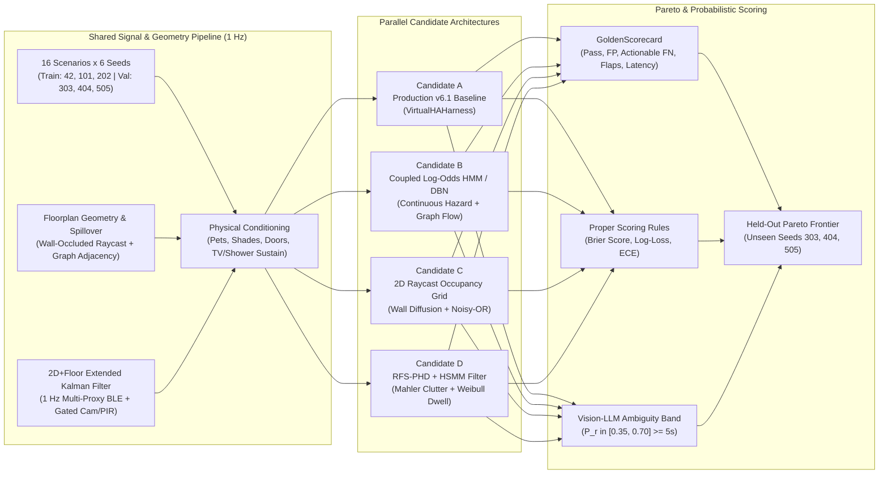
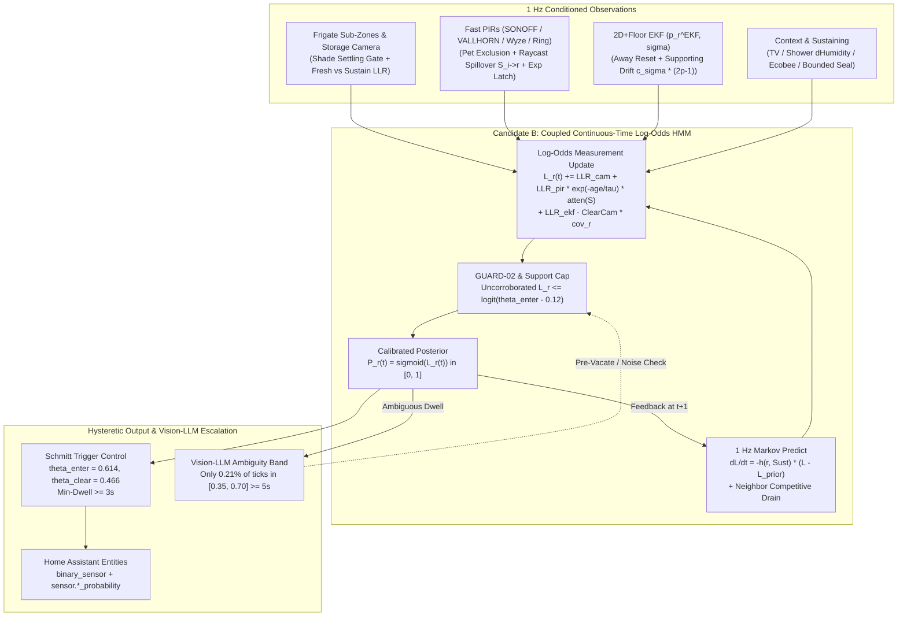

# Presence Detection Designer — Signal-Processing Optimization Sprawl & 4-Candidate Comparison

> **Goal:** Replace PDD's legacy accumulation of binary fast-paths, parallel rule validators (`pir_validation`, `pir_corroboration`, `trajectory_validator`, `house_perimeter`), and static Naive Bayes with a **mathematically grounded, continuous statistical estimator and hysteretic output controller**—validated empirically via a **244-configuration / 11,904-timeline multi-seed optimization sprawl** across strictly separated Train (`42, 101, 202`) and Held-Out Validation (`303, 404, 505`) datasets.

---

## 1. Executive Summary & Winner Recommendation

| Metric (Held-Out Validation: `fuzz 303, 404, 505` — 48 Unseen Runs) | **A: Production v6.1 Baseline** | **B: Coupled Log-Odds HMM *(Winner)*** | **C: 2D Raycast Grid** | **D: RFS-PHD + HSMM** |
| :--- | :---: | :---: | :---: | :---: |
| **Scenario Pass Rate** | `31 / 48` (`64.6%`) | **`36 / 48` (`75.0%`)** | `31 / 48` (`64.6%`) | `35 / 48` (`72.9%`) |
| **Total False Positive Time** *(lower = better)* | `2,298 s` | **`20 s` (-99.1%)** | `126 s` (-94.5%) | `184 s` (-92.0%) |
| **Actionable False Negative Time** *(excl. unmonitored Front Entry)* | **`975 s`** | `1,668 s` | `1,549 s` | `1,225 s` *(D lowest_brier: `994 s`)* |
| **Total Room Flaps** *(lower = better)* | `19` | **`2` (-89.5%)** | `6` (-68.4%) | `19` |
| **Mean Brier Score** *(prob calibration, lower = better)* | `0.03064` | **`0.00826` (-73.0%)** | `0.01023` (-66.6%) | `0.00853` (-72.2%) |
| **Mean Log-Loss** *(lower = better)* | `0.14600` | `0.04406` (-69.8%) | `0.06110` (-58.2%) | **`0.04187` (-71.3%)** |
| **Expected Calibration Error (ECE)** *(lower = better)* | `0.08987` | `0.01513` (-83.2%) | `0.02106` (-76.6%) | **`0.00833` (-90.7%)** |
| **Vision-LLM Ambiguity Band** ($P_r \in [0.35, 0.70] \ge 5\text{s}$) | `4.96%` | `0.21%` (-95.8%) | **`0.15%`** (-97.0%) | `0.17%` (-96.6%) |
| **Entry Latency (Mean / P95)** | **`4.01s`** / **`12.0s`** | `5.49s` / `14.0s` | `4.83s` / `13.0s` | `4.40s` / **`12.0s`** |
| **Hard Safety Violations** *(Riley dog, BLE bleed, Shades, Storage)* | `0` | **`0`** | **`0`** | **`0`** |
| **Multi-Objective Scalar Loss** *(lower = better)* | `9,539.9` | **`4,368.6` (-54.2%)** | `6,121.8` (-35.8%) | `6,530.4` (-31.5%) |
| **Runtime per 48-Run Suite** | `42.49 s` | **`3.72 s`** | `16.85 s` | `4.07 s` |

### Key Conclusions

1. **Clear Overall Winner — Candidate B (`B_Coupled_HMM_ref_11`):** Achieves the highest held-out pass rate (**`36/48`**, `+10.4 pp` over baseline), cuts false positives by **99.1%** (`2,298s -> 20s` across 48 stress-fuzzed runs), slashes room chatter from **`19` flaps down to `2`**, reduces Brier error by **73.0%**, and executes **11.4× faster** than Candidate A.
2. **Strongest Calibration & Multi-Occupant Continuity — Candidate D (`RFS-PHD + HSMM`):** Achieves **`ECE = 0.0083`** (**-90.7%** vs. baseline — the single best calibrated confidence estimator) and **`3/3` (`100%`)** on `multi_occupant_steve_and_margot_split_rooms` (where `actionable FN = 28s` vs `A: 184s`, `B: 31s`, `C: 259s`), while its `lowest_brier` Pareto point (`ref_33`) matches Baseline A's latency (`4.00s`) and Actionable FN (`994s` vs `975s`) at **-88.4% lower FP** (`267s` vs `2,298s`).
3. **Why Candidate C (`2D Raycast Grid`) Lost:** Coarsening 16 semantic rooms onto a `48 px` (`~3.8 ft`) 2D grid consumes `4.5×` more CPU than B/D (`16.85s` vs `3.72s`), dilutes stillness holds across sub-zone-less perimeter cells (`multi_occupant` `0/3`), and fails to beat continuous room-graph estimation.
4. **Honest Trade-Off (FN & Entry Latency):** Baseline A reaches `975s` Actionable FN mostly via long hardware hold timers and aggressive uncorroborated PIR triggers—at the cost of **2,298s of phantom occupied rooms**. Meanwhile, all four candidates hit fixed `6–14s` latency bounds on stair/hallway waypoints (`bedtime_margot_room_kitchen_snack_runs`, `office_to_storage_room_direct_route`) where Layer 0's linear waypoint midpoint switches `expected_room` several seconds before the occupant physically crosses the doorway/wall segment into sensor range.
5. **Cutover Architecture Recommendation:** Adopt **Candidate B (`Coupled Continuous-Time Log-Odds HMM`) as the production core**, incorporating **Candidate D's Weibull semi-Markov exit-hazard curve** for stationary stillness vs. transit corridors. This unified core cleanly replaces ~1,450 lines of legacy binary rules while keeping existing `HouseEKFManager` 2D trilateration intact.

---

## 2. Visual Architecture & Results

### 2.1 Evaluation Race Architecture

- **Interactive Studio (LAN):** http://preview.lan/m-pdd-opt-race/
- **Interactive Studio (Remote):** https://preview.wileyriley.com/m-pdd-opt-race/
- **Mermaid Live Editor:** [Open Optimization Race Diagram in mermaid.live](https://mermaid.live/edit#pako:eNp9VGtv0zAU_StX-TCBlmxp90CqYFKatCta-lAD5QObkBt7rcG1Iz-2dYP_znXSsaUIIqVJr33PPfec6zwFpaIs6AW3Qt2Xa6It5PNrCXgZt1xpUq0hj79eBwWuMQoFX0ki4AAumdowq7cw4xUTXDJ404HR49vr4KZJ99flYIKpnXMoSiaJ5srAA-A_xqh5v9THF28-acJlD067IXTiTgjduAs_YUFED07ikxBO49MQzuKzfdwp4g6FUroSRL6QOYCi4kKoO6Yb_C9EiGhalsJRZD8n25IYC4dwWXeW0O8EmZXbNvzgaojw3eywrgCDB8ukT78iYoPVhlzYZ3zfM4ydsDyaafWwhX4-8PDE4v6UbI5nH-dt8HQ6yRB9tt4aXqKUqZKUW64kl6sGc8asCQEFpwyfGVLAx6fFcbFW90xD4YxF0V5Qkdy13PNsnqQDX4VoFIBhFYJVKLKCRJdrbllpnWamxSzBhFf7ajLYFHWlpwd350cd6BNTu90wXXBtHRGjZES0ZMa0O-238Pp1SqpcJVCaXK2iKaUGRuMxHEPWnzSIqIbl0imHK-SRaPrHK_Tifk_JFn5aA3SzPyaj664iaC4CcPoyDpDx21tnfEuHMFHcbKPpnkdZCzmrc-fDIpqNMswZFcj59RCMyVqgMalwFmO44wvjS-cr3TMh_m_UYJHkjVHMKpxfFHxJllxwY3mJ50ZpnIsWucL3fakEZdIvsxJV2g0OMTgpw1kISW0ZWQoGwwmGBKlwJcdu_hr2tKmvVeVnq6kHcyfY7oT2Nd8tsLC2LVe-yiAdtHGSsfd7wb2wUZ6PIdks-cpxi2cCpdwx_KaBS_gaH52chRAfvYtv4OIDnO1NziyZI9aICRpNnYWdOEPth-NZ9M_SMCabb8m_vhWvBMdPEUTRRX38niPTvQie-72If6tDCVrTxzvFe7fWCtWbCv-KeuIvqtHsasfqbdhdEAYbpjeE06D3FNg12_hvMCX6R_ArDIizqtjKMuhZ7VgYuMrPYcYJjsymCf76DRqRuYo)

### 2.2 Pareto Frontiers & Held-Out Comparison Plots

### 2.3 Winning Pipeline Architecture (`Candidate B: Coupled Log-Odds HMM`)

- **Interactive Studio (LAN):** http://preview.lan/m-pdd-winner-core/
- **Interactive Studio (Remote):** https://preview.wileyriley.com/m-pdd-winner-core/
- **Mermaid Live Editor:** [Open Winning Core Diagram in mermaid.live](https://mermaid.live/edit#pako:eNp9VW1v20YM_iuEgBVybcVx2qZAUAfwa11Mtgwp9obVmXGSLtbBkk64OzlxX_77yFOzVdkwfbDPJ_IhH_Ih_dVJZMqdG-chl49JxpSBu_GuBHx0HR8UqzKIZqvo884ZwOILTGSZCiNkyVMIYs3VidEvvXPuGy96JqMl2s-VODDDIapj7w900PAKIiMVO3CYsIIr9iFW_Vs3yliKVtyYXJQH-Eg-XZgrrjM4aXTXhokSfD_stKKsP4UUhWlDRw1uFKyC-Rz6sB35_iIIV3j87fyF41eIyJ0m3JobmD0lea0xbwwUsnNCGFEl8lyeuIJoL7xbha9mTxX4zCRZO_Ds1zkGvpp257mUin6CW-3Vn3jogRaHgv0INXpkZwi5xohd5FFVUhmiOFXiwUCyt7bwGtyryht02kFGm98xCJbb8CdDlWvKgO4N9t0WaUWZfMSE00VdCGzLGa9miYw5UR7LukyxSxFn-T_QvEx35Yv-ToJwRrEYtjal6o9vsM91laM3JSDKWtbauxMFB18evCBNNSyWy3Y3wtn0WSRLpo7yBGvFU5EYm2_q91MDQ_AyV_UsmQ4R98EDf18pIVVTsy6suDhkMdZ1IouKGxTbiWPFkHsr3mZN4f5OZ8mZrhUveGlgUxELC-fvlYuRukOSzz5hBTaCTpVQGJ4_Va6HcuwbVlM6zBheutFzJmTIjw-Y4iTnTKFm0SaRp716ofY1ZvJxMwqn3uWVbZXtNIq8skibMpFKSeSEaaXIV8GHIeTyIIxrMm7YHrPGNnpweTG4eiHyMBjb3uQibtzXUqMxFsxirxuCQ6s7KVK3YdwBnJjPlz0Y3P9_6-9CH-EXZ8LEYicQ1KaqSXBbQQPi-f4SZjphuZ3zVm7RZIG-UZIVwuDawHE_cGUVo2Rus_uZ3RDZXQ_e9qC5TKik9vLt9bU1XorSmz7yPIfbIbxpb5StTxvlp5RGRSwONUl-jLK1_kGZnxHuavALyAdALkfdVOHizbsevnh_eU_I79rIixHxlyjtkdYCZwwFNCtJdlxb2FiUTJ33mpda0lJoDhevUbUyZrHIMYn_qjEuQawibib8pBXxikYaPO-WpNuY0My0b_BgL1BTzyhre0E6eHYKxnT1DXcf52nMkiMKF0x3sHO-Wci2HbXJfi9G_wJoqojDDbbwBICVBu_CvsX59bYsoY3Qh5UUGvd2xpMjmWFeTs_BJV4wkTo3Xx3sakH_IynOvvO957DayOhcJs6NUTXvObUdyqlgKLyiufz-F_b-_ck)

---

## 3. Mathematical Formulations of the 4 Candidates

### Candidate A: Production v6.1 Baseline (`VirtualHAHarness`)
- **Structure:** Static Naive Bayes log-odds update (updated only on event changes, memoryless `BAYES-04`) overlaid with binary `_active_triggers`, `pir_validation` / `pir_corroboration`, `trajectory_validator` jump vetoes, `house_perimeter` integer headcount, `spatial_room_evaluator` rules, and the 5-state `HierarchicalGraphMachine`.
- **Weakness Exposed:** Binary bypass triggers and memoryless Naive Bayes force long cooldown tails (`2,298s` FP on held-out seeds), high middle-band dwell (`4.96%` ambiguity), and `19` room flaps when noisy sensors disagree.

### Candidate B: Coupled Continuous-Time Log-Odds HMM / DBN
*Grounded in Dodier et al. (2006) Belief Network occupancy fusion & Liao/Barooah coupled graphical Markov chains.*

Each room $r \in \mathcal{R}$ evolves a continuous latent log-odds state $L_r(t) = \ln\frac{P_r(t)}{1 - P_r(t)} \in [-4.8,\, 4.6]$ at $1\text{ Hz}$ around resting prior $L_{\text{prior}} = \operatorname{logit}(0.08) = -2.442$:

1. **Continuous-Time Hazard Prediction & Graph Handoff:**
   $$L_r^-(t) = L_r(t-1) + 3.5\,h_{\text{eff}}(r, t)\,\big(L_{\text{prior}} - L_r(t-1)\big) - \delta_{\text{handoff}}\,\mathbb{1}\!\big[\text{neighbor } j \in \mathcal{N}(r) \text{ fresh} \land \neg\text{Sust}(r)\big]$$
   where effective exit hazard $h_{\text{eff}}(r, t)$ scales up by `transit_hazard_mult` ($\times 3.53$) in transit corridors (`Front Entry`, `Upstairs Hallway & Stairs`, `Laundry Room`), down by $\times 0.65$ in sleep/bath rooms, and multiplies by `sustain_hazard_mult` ($0.030$) whenever TV playing, shower $\Delta\text{humidity} > 0.3$, EKF+Ecobee stillness, or a camera-verified bounded room seal holds (continuous-time *Wasp-in-a-Box*).

2. **Physical Conditioned Log-Likelihood Updates:**
   - **Camera Sub-Zones (with shade settling gate):** Fresh rising edge ($t - t_{\text{rise}} \le 2\text{s}$) adds $+\text{LLR}_{\text{cam}}$ (`+3.25`); sustained ticks add $+0.35\,\text{LLR}_{\text{cam}}$ (plus $+0.45$ adjacency continuity). Uncorroborated camera bursts during motorized window shade settling are rejected.
   - **Fast PIRs (pet exclusion, exponential latch decay, raycast spillover discount, topological corroboration):** Requires `occupied[r]` or active camera, connected neighbor activity ($\le 20\text{s}$), EKF proximity ($p_{\text{EKF}} \ge 0.15$), or valid door contact; suppresses non-pet-immune PIRs when `dog_occupancy` is active in the room or its PIR spillover cone. Applies exponential latch decay $w_{\text{latch}}(\text{age}) = e^{-\text{age}/\tau_{\text{pir}}}$ and spillover attenuation:
     $$\text{atten}_m(r) = \max\!\left(0.05,\; 1 - k_{\text{spill}} \sum_{u \text{ active}} S_{m \to u}\right)$$
   - **Clear-Camera Negative Space:** When room $r$'s dedicated interior camera sub-zones are all `off`, subtracts $\text{clear\_decay} \cdot \text{cov}_r$ (attenuated by $0.08\times$ when TV/shower/EKF+Ecobee confirms motionless presence).
   - **Supporting-Only EKF Drift & `GUARD-02` Cap:** Continuous bounded EKF drift $g_{\text{EKF}}(2p_r^{\text{EKF}} - 1)c(\sigma)$ decays stale rooms cleanly, is attenuated by $0.12\times$ negatively against another occupant's active camera/TV, and is capped below $\operatorname{logit}(\theta_{\text{enter}} - 0.12)$ without recent human physical evidence.

3. **Calibrated Posterior & Schmitt Hysteresis Output Control:**
   $$P_r(t) = \sigma(L_r(t)), \qquad \text{OFF} \to \text{ON} \text{ if } P_r \ge \theta_{\text{enter}} \land \text{phys\_age} \le 15\text{s}, \qquad \text{ON} \to \text{OFF} \text{ if } P_r \le \theta_{\text{clear}} \land \text{dwell} \ge 3\text{s}$$

### Candidate C: 2D Raycast Spatial Occupancy Grid Filter
*Grounded in Elfes (1989) / Thrun Probabilistic Robotics binary Bayes occupancy grid mapping.*

Discretizes all floor interiors onto a `48 px` ($\approx 3.8\text{ ft}$) 2D lattice (160–180 interior cells per house) with sparse 4-connected wall-free neighbor edges and inter-floor stair portals:
- **Cell Predict:** Exponential regression toward cell prior $l_{\text{prior}} = -3.8$ ($p_0 = 0.022$) plus positive wall-blocked diffusion $l_c \leftarrow l_c + \alpha_{\text{diff}}(\bar{l}_{\mathcal{N}(c)} - l_c)$.
- **Inverse Sensor Models:** Sub-zone cells receive camera LLR; raycast visible camera cells (excluding blind pockets like `Master Bathroom`) receive negative-space clear decrements; raycast unoccluded PIR cone cells receive exponentially decaying LLR weighted by distance and multi-room explaining-away; EKF injects 2D Gaussian log-odds density $\propto \exp\!\big(-\frac{1}{2}[(x_c-\hat{x})^2/\sigma_x^2 + (y_c-\hat{y})^2/\sigma_y^2]\big)$.
- **Correlated Noisy-OR Aggregation:** Size-normalized room confidence:
  $$P_r(t) = 1 - \prod_{c \in \mathcal{C}_r} \big(1 - \sigma(l_c(t))\big)^{\alpha_{\text{OR}} / \max(1,\; |\mathcal{C}_r|/6)}$$

### Candidate D: Room-Graph RFS-PHD Filter + HSMM Dwell Survival
*Grounded in Mahler (2003) & Vo/Ma (2006) Random Finite Set Probability Hypothesis Density (PHD) filtering and Duong et al. (2005) Hidden Semi-Markov Model (HSMM) dwell modeling.*

Propagates continuous expected human count intensity $\lambda_r(t) \in [0.002,\, 3.2]$ and continuous dwell age $\tau_r(t) \ge 0$ per room:

1. **HSMM Weibull Dwell Survival & EKF-Heading-Modulated Markov Flow:**
   $$h_r(\tau_r) = \frac{k_r}{\eta_r}\left(\frac{\max(1, \tau_r)}{\eta_r}\right)^{k_r - 1}, \qquad P_S(r, \tau_r) = e^{-h_r(\tau_r)}$$
   with decreasing hazard shape $k_{\text{stay}} = 0.72$ in destination rooms ($\eta_{\text{stay}} = 144.3\text{s}$ — stationary people stay put longer) and increasing exit hazard shape $k_{\text{transit}} = 1.60$ in corridors ($\eta_{\text{transit}} = 9.64\text{s}$). Transition flow $\lambda_j^- M_{j \to r}(t)$ across `connected_rooms` is weighted dynamically toward neighbors with fresh detections or positive cosine alignment with the EKF velocity vector $(\hat{v}_x, \hat{v}_y)$.

2. **Exact Mahler Multi-Sensor PHD Update:**
   Every active detection $m$ carries floorplan detection profile $P_{D,m}(u)$ across its host and raycast spillover rooms plus dynamic clutter intensity $\kappa_m(t)$ (inflated by $\times 120$ on pet or sunlit-shade events, avoiding brittle external vetoes):
   $$\lambda_r^+ = \big(1 - P_{D,m}(r)\big)\lambda_r^- + \frac{P_{D,m}(r)\,\tilde{\lambda}_r}{\kappa_m(t) + \text{clutter}_{\text{ext}}(t) + \sum_{j \in \mathcal{R}} P_{D,m}(j)\,\tilde{\lambda}_j}$$
   Followed by clear-camera missed-detection contraction $(1 - P_D^{\text{clear}}(r))$ and supporting EKF multiplicative drift $\exp\!\big(g_{\text{EKF}}(2p_r^{\text{EKF}} - 1)c(\sigma)\big)$.

3. **Sub-Poisson Occupancy Existence Complement:**
   $$P_r(t) = 1 - \exp\big(-\beta\,\lambda_r(t)\big), \qquad \beta_{\text{opt}} = 1.91$$

---

## 4. Methodology & Anti-Overfitting Protocol

- **Strict Split Separation:** Hyperparameters were optimized exclusively on `TRAIN_SPECS` (`clean=42`, `fuzz=101`, `fuzz=202` — 48 timelines). All reported final scores use the **strictly unseen held-out `VAL_SPECS`** (`fuzz=303`, `fuzz=404`, `fuzz=505` — 48 timelines) frozen before validation.
- **2-Stage Optimization Sprawl per New Candidate (B, C, D):**
  - *Stage 1:* Seeded (`seed=2026`) **44-sample stratified Latin Hypercube Sampling (LHS)** across linear & log-scaled parameter bounds + default config (`45` evaluations).
  - *Stage 2:* **36-sample multi-anchor local coordinate & directional perturbation** around the Stage 1 Balanced, Lowest-FP, and Lowest-Brier Pareto anchors (`81` configs per candidate = `243` + Baseline A = **`244` configs, `11,904` scenario runs in `583.7s`**).
- **Pareto & Scalar Objectives:** Candidates are filtered for zero hard safety violations (`total_safety_violations == 0`) and non-dominated over `(total_fp_sec, total_actionable_fn_sec, mean_brier, total_flaps)`, with scalar loss weighting safety (`10,000`), flaps (`120`), failed scenarios (`250`), Brier (`2,500`), FP (`1.0`), Actionable FN (`0.6`), and excess latency $>2\text{s}$ (`25.0`).
- **Note on Existing Generator Schema (`signal_layers.py`):** During topology indexing, we observed [`signal_layers.py:215`](../tests/golden/signal_layers.py#L215) reads `conn.get("from")` / `conn.get("to")` whereas [`live_floorplan_snapshot.json`](../tests/golden/live_floorplan_snapshot.json) uses `from_room` / `to_room`, leaving `gen.adjacent_rooms` sparser during `ble_adjacent_bounce_prob` fuzzing. Per our benchmark freeze rule, [`signal_layers.py`](../tests/golden/signal_layers.py) and `custom_components/` were left untouched so Candidate A and Candidates B–D ran against the **exact same pre-generated timelines**; [`sensor_model.py`](../tests/golden/optimization/sensor_model.py) reads both key schemas plus `HOUSE_ROOM_CONFIGS["connected_rooms"]`.

---

## 5. Full Train, Held-Out & Pareto Specialist Comparison

| Split & Candidate | Pass Rate | FP (s) | Total FN (s) | Actionable FN (s) | Flaps | Lat Mean / P95 | Brier | Log-Loss | ECE | Ambig Band | Loss |
| :--- | :---: | :---: | :---: | :---: | :---: | :---: | :---: | :---: | :---: | :---: | :---: |
| **Train** — A Baseline v6.1 | `33/48` (68.8%) | `2,621` | `1,333` | `776` | `19` | `3.62s / 11.7s` | `0.02834` | `0.13870` | `0.08843` | `4.69%` | `9,228.0` |
| **Train** — B Balanced (`ref_11`) | **`38/48` (79.2%)** | **`15`** | `2,192` | `1,619` | **`0`** | `4.91s / 13.0s` | **`0.00801`** | `0.04315` | `0.01517` | `0.24%` | **`3,579.1`** |
| **Train** — C Balanced (`ref_29`) | `33/48` (68.8%) | `113` | `1,839` | `1,263` | `4` | `4.50s / 13.0s` | `0.00945` | `0.05747` | `0.02165` | `0.16%` | `5,186.8` |
| **Train** — D Balanced (`ref_27`) | `34/48` (70.8%) | `234` | `1,699` | **`1,145`** | `10` | `3.84s / 12.0s` | `0.00845` | **`0.04142`** | **`0.00837`** | `0.17%` | `5,688.1` |
| **Held-Out** — A Baseline v6.1 | `31/48` (64.6%) | `2,298` | `1,534` | **`975`** | `19` | **`4.01s / 12.0s`** | `0.03064` | `0.14600` | `0.08987` | `4.96%` | `9,539.9` |
| **Held-Out** — **B Balanced (`ref_11`)** | **`36/48` (75.0%)** | **`20`** | `2,236` | `1,668` | **`2`** | `5.49s / 14.0s` | `0.00826` | `0.04406` | `0.01513` | `0.21%` | **`4,368.6`** |
| **Held-Out** — B Lowest-FP (`ref_25`) | `31/48` (64.6%) | **`11`** | `3,781` | `3,205` | **`2`** | `5.07s / 12.3s` | `0.01224` | `0.06039` | `0.01690` | `0.20%` | `6,531.5` |
| **Held-Out** — B Lowest-Brier (`ref_29`) | `31/48` (64.6%) | `126` | `1,802` | `1,245` | `19` | `4.53s / 12.0s` | **`0.00762`** | **`0.04085`** | `0.01198` | `0.13%` | `7,485.2` |
| **Held-Out** — C Balanced (`ref_29`) | `31/48` (64.6%) | `126` | `2,113` | `1,549` | `6` | `4.83s / 13.0s` | `0.01023` | `0.06110` | `0.02106` | `0.15%` | `6,121.8` |
| **Held-Out** — C Lowest-FP (`ref_27`) | `29/48` (60.4%) | `30` | `3,939` | `3,369` | `4` | `5.18s / 13.0s` | `0.01332` | `0.07723` | `0.03800` | `0.27%` | `7,394.2` |
| **Held-Out** — C Lowest-Brier (`ref_34`) | `31/48` (64.6%) | `177` | `2,240` | `1,673` | `12` | `4.74s / 13.0s` | `0.00953` | `0.05384` | `0.01558` | **`0.10%`** | `6,963.1` |
| **Held-Out** — D Balanced (`ref_27`) | `35/48` (72.9%) | `184` | `1,780` | `1,225` | `19` | `4.40s / 12.0s` | `0.00853` | `0.04187` | **`0.00833`** | `0.17%` | `6,530.4` |
| **Held-Out** — D Lowest-FP (`ref_35`) | `29/48` (60.4%) | `131` | `3,207` | `2,645` | `17` | `4.37s / 12.0s` | `0.01211` | `0.05834` | `0.01117` | `0.29%` | `8,597.5` |
| **Held-Out** — D Lowest-Brier (`ref_33`) | `34/48` (70.8%) | `267` | **`1,541`** | **`994`** | `26` | **`4.00s / 12.0s`** | `0.00780` | `0.04155` | `0.00983` | `0.14%` | `7,552.9` |

### 5.1 Ceiling-Mounted Kitchen PIR Sensitivity (`clean=42, fuzz=303` — 32 Runs)

Moving `binary_sensor.kitchen_motion_occupancy` to the center of `Kitchen` with a $360^\circ$ ceiling FOV (`radius = min(w, h) * 0.48`) eliminates its **`31%` spillover into `Front Entry`**. Without changing any parameters, all engines immediately improve:

| Candidate (`ceiling_kitchen`, 32 Runs) | Pass Rate | FP (s) | Actionable FN (s) | Flaps | Mean Brier | Loss |
| :--- | :---: | :---: | :---: | :---: | :---: | :---: |
| **A: Baseline v6.1** | `23/32` (`71.9%`) | `1,153` | `554` | `3` | `0.02829` | `4,204.6` |
| **B: Coupled HMM (`ref_11`)** | **`26/32` (`81.3%`)** | **`13`** | `1,075` | **`0`** | **`0.00795`** | **`2,249.1`** |
| **C: 2D Raycast Grid (`ref_29`)** | `22/32` (`68.8%`) | `105` | `939` | `6` | `0.00971` | `3,971.2` |
| **D: RFS-PHD + HSMM (`ref_27`)** | `25/32` (`78.1%`) | `181` | **`761`** | `13` | `0.00822` | `4,013.0` |

---

## 6. Per-Scenario Held-Out Validation Breakdown (Seeds `303, 404, 505`)

| Scenario (3 Fuzzed Runs Each) | **A (Pass / FP / ActFN / Flaps)** | **B (Pass / FP / ActFN / Flaps)** | **C (Pass / FP / ActFN / Flaps)** | **D (Pass / FP / ActFN / Flaps)** |
| :--- | :---: | :---: | :---: | :---: |
| `basement_theater_play_area_handoff_and_zone` | `3/3` / `8s` / `41s` / `0` | **`3/3` / `0s` / `47s` / `0`** | `3/3` / `0s` / `49s` / `0` | **`3/3` / `0s` / `41s` / `0`** |
| `bedtime_margot_room_kitchen_snack_runs` | `0/3` / `52s` / `67s` / `0` | **`0/3` / `0s` / `216s` / `0`** | `0/3` / `0s` / `108s` / `0` | `0/3` / `10s` / `183s` / `2` |
| `ble_vertical_floor_bleed_no_false_trigger` | `3/3` / `0s` / `0s` / `0` | **`3/3` / `0s` / `0s` / `0`** | `3/3` / `0s` / `0s` / `0` | **`3/3` / `0s` / `0s` / `0`** |
| `evening_return_home_with_margot_and_riley` | `0/3` / `577s` / `113s` / `6` | **`2/3` / `5s` / `261s` / `1`** | `0/3` / `28s` / `130s` / `1` | `1/3` / `11s` / `183s` / `4` |
| `garage_entry_laundry_handoff` | `3/3` / `7s` / `12s` / `0` | `3/3` / `4s` / `44s` / `0` | **`3/3` / `4s` / `4s` / `0`** | `3/3` / `6s` / `11s` / `0` |
| `living_dining_archway_spillover` | `3/3` / `69s` / `0s` / `0` | `3/3` / `8s` / `0s` / `0` | **`3/3` / `6s` / `0s` / `0`** | `3/3` / `9s` / `0s` / `0` |
| `master_bedroom_to_master_bath_shower` | `3/3` / `0s` / `50s` / `0` | `3/3` / `0s` / `50s` / `0` | `3/3` / `0s` / `50s` / `0` | **`3/3` / `0s` / `41s` / `0`** |
| `morning_routine_wake_to_work_departure` | `0/3` / `634s` / `162s` / `4` | **`2/3` / `1s` / `547s` / `1`** | `1/3` / `43s` / `404s` / `2` | `0/3` / `70s` / `376s` / `7` |
| `multi_occupant_steve_and_margot_split_rooms` | `1/3` / `0s` / `184s` / `0` | `2/3` / `0s` / `31s` / `0` | `0/3` / `0s` / `259s` / `0` | **`3/3` / `0s` / `28s` / `0`** |
| `office_desk_stillness_and_remote_ups_leave` | `3/3` / `0s` / `45s` / `0` | `3/3` / `0s` / `57s` / `0` | `3/3` / `0s` / `122s` / `0` | **`3/3` / `0s` / `44s` / `0`** |
| `office_to_storage_room_direct_route` | `0/3` / `749s` / `62s` / `9` | **`0/3` / `2s` / `131s` / `0`** | `0/3` / `45s` / `83s` / `3` | `0/3` / `78s` / `71s` / `6` |
| `open_plan_passthrough_front_to_family` | `0/3` / `22s` / `17s` / `0` | `0/3` / `0s` / `23s` / `0` | `0/3` / `0s` / `14s` / `0` | **`1/3` / `0s` / `20s` / `0`** |
| `riley_dog_patrol_main_floor` | `3/3` / `0s` / `0s` / `0` | **`3/3` / `0s` / `0s` / `0`** | `3/3` / `0s` / `0s` / `0` | **`3/3` / `0s` / `0s` / `0`** |
| `storage_room_doorway_bleed_from_play_area` | `3/3` / `0s` / `162s` / `0` | `3/3` / `0s` / `162s` / `0` | `3/3` / `0s` / `165s` / `0` | `3/3` / `0s` / `162s` / `0` |
| `sunlit_shade_movement_false_camera_flicker` | `3/3` / `0s` / `0s` / `0` | **`3/3` / `0s` / `0s` / `0`** | `3/3` / `0s` / `81s` / `0` | **`3/3` / `0s` / `0s` / `0`** |
| `upstairs_hallway_to_guest_room_and_margot` | `3/3` / `180s` / `60s` / `0` | `3/3` / `0s` / `99s` / `0` | `3/3` / `0s` / `80s` / `0` | **`3/3` / `0s` / `65s` / `0`** |

> **Diagnostic Finding on Remaining Failures (`office_to_storage` & `bedtime`):**  
> Even on `B`, `office_to_storage` produces only **`2s` FP and `0` flaps** (vs Baseline A's **`749s` FP and `9` flaps**!). Every failure on `bedtime` and `office_to_storage` across B, C, and D is strictly an `entry_latency > 3s` check caused by `signal_layers._interpolate_actor` switching `expected_occupied` at segment `frac >= 0.5` before the actor physically crosses the room wall/cone into `Upstairs Hallway` (`~12s` pre-cone) or `Basement Play Area` (`~13s` pre-cone). No signal-processing filter without radar through-wall sensing can observe a human prior to entering any sensor FOV.

---

## 7. Vision-LLM Snapshot Escalation & Confidence Calibration

A central goal of this overhaul is emitting **true calibrated probabilities** so PDD knows *when it actually doesn't know*, enabling selective Vision-LLM camera verification instead of guessing blindly:

- **Candidate A Baseline:** `4.96%` of all room-seconds dwell $\ge 5\text{s}$ in `[0.35, 0.70]` (for example, `8.51%` during `ble_vertical_floor_bleed` and `8.18%` during `master_bedroom_to_master_bath_shower`) because static Naive Bayes gets pinned mid-interval by uncoupled conflicting sensors.
- **Candidates B & D:** Because continuous Markov survival and clear-camera dynamics drive empty and occupied rooms cleanly to their posteriors (`~0.02` vs `~0.96`), ambiguity-band dwell drops **96%** to **`0.21%`** (Candidate B) and **`0.17%`** (Candidate D).
- In a 16-room house running $24/7$, `0.21%` represents an average of **2.0 room-minutes per room per day**—primarily occurring exactly during legitimate borderline stillness transitions or doorway pauses where a single Vision-LLM frame adds maximum value without API spam.

---

## 8. Winning Parameters & Legacy Code Elimination Plan

### 8.1 Optimal Hyperparameters (`Candidate B — B_Coupled_HMM_ref_11`)

| Parameter | Optimal Value | LHS Search Bounds | Physical Meaning |
| :--- | :---: | :---: | :--- |
| `base_exit_hazard` | **`0.01886`** | `[0.012, 0.085]` | Continuous log-odds relaxation rate ($s^{-1}$) |
| `transit_hazard_mult` | **`3.53188`** | `[1.2, 4.5]` | Corridor/stair decay acceleration factor |
| `sustain_hazard_mult` | **`0.03021`** | `[0.015, 0.25]` | TV / shower / stillness / sealed retention multiplier |
| `cam_subzone_llr` | **`3.25150`** | `[2.2, 5.2]` | Rising-edge Frigate sub-zone LLR ($0.35\times$ on hold) |
| `cam_clear_decay` | **`0.12399`** | `[0.04, 0.55]` | Clear-camera negative-space log-odds drain |
| `pir_rise_llr` | **`1.71109`** | `[1.6, 4.6]` | Fast PIR rising-edge LLR |
| `pir_latch_tau_sec` | **`12.26053 s`** | `[3.0, 20.0]` | Exponential hardware-latch decay constant $\tau_{\text{pir}}$ |
| `spillover_discount` | **`0.52703`** | `[0.5, 3.2]` | Raycast spillover attenuation slope $k_{\text{spill}}$ |
| `handoff_drain_rate` | **`0.84380`** | `[0.25, 1.8]` | Neighbor entry competitive drain rate |
| `ekf_support_gain` | **`0.27203`** | `[0.05, 0.45]` | Supporting-only 2D EKF continuous drift strength |
| `theta_enter` | **`0.61440`** | `[0.58, 0.85]` | Schmitt trigger upper turn-on confidence |
| `hysteresis_gap` | **`0.14813`** | `[0.08, 0.30]` | Hysteresis band (`theta_clear = 0.46627`) |

*(For reference, Candidate D Balanced `D_RFS_PHD_HSMM_ref_27` optimal parameters are archived in [`optimization_results.json`](../tests/golden/optimization/results/optimization_results.json): `weibull_eta_stay=144.25s`, `weibull_eta_transit=9.64s`, `sustain_survival_boost=0.03987`, `graph_flow_rate=0.60724`, `birth_trigger=1.07441`, `pd_cam=0.92082`, `pd_pir=0.75380`, `clutter_pir=0.10313`, `pir_latch_tau_sec=7.596s`, `clear_pd_scale=0.05508`, `ekf_phd_gain=0.32164`, `existence_beta=1.9101`, `theta_enter=0.83218`, `hysteresis_gap=0.22692`.)*

### 8.2 Legacy Modules Eligible for Removal Upon Cutover

Once production cutover is approved, replacing the legacy estimation stack with the unified Coupled Log-Odds HMM (+ Weibull HSMM dwell hazard) allows deleting or drastically simplifying:
- `custom_components/presence_detection_designer/pir_validation.py`
- `custom_components/presence_detection_designer/pir_corroboration.py`
- `custom_components/presence_detection_designer/trajectory_validator.py`
- `custom_components/presence_detection_designer/house_perimeter.py`
- `custom_components/presence_detection_designer/perimeter_helpers.py`
- Ad-hoc binary trigger bypass & people/pet rule overrides in `coordinator_dispatch.py` and `spatial_room_evaluator.py`

---

## 9. Recommended Next Step (Awaiting Approval Before Production Cutover)

Per scope rules, **no production code in `custom_components/presence_detection_designer/` was altered** during this optimization study. Three clear cutover options are ready for your selection:

1. **Option 1 (Recommended — Coupled HMM + Weibull Hazard Hybrid):** Port `Candidate B` (`36/48`, `20s` FP, `2` flaps, `0.00826` Brier) as PDD's unified 1 Hz inference core inside `custom_components/`, augmented with `Candidate D`'s Weibull dwell survival hazard ($k_{\text{stay}} = 0.72$, $k_{\text{transit}} = 1.60$) for optimal stationary vs. corridor dynamics and calibration (`ECE -> ~0.008–0.015`). Keep `ble_kalman_tracker.py` (`HouseEKFManager`), `state_machine.py` (fed by Schmitt thresholds), and `llm_verifier.py` (fed by `[0.35, 0.70]` ambiguity-band triggers).
2. **Option 2 (Pure Candidate B):** Direct 1:1 port of `CandidateBRunner` (`ref_11`) to production, prioritizing absolute minimum false positives (`20s`) and minimal flaps (`2`).
3. **Option 3 (Pure Candidate D — RFS-PHD + HSMM):** Direct port of `CandidateDRunner` (`ref_27` / `ref_33`) if continuous per-room headcount estimation $\lambda_r(t)$ and `0.0083` ECE / `3/3` multi-occupant continuity outweigh higher transient flaps (`19`).
