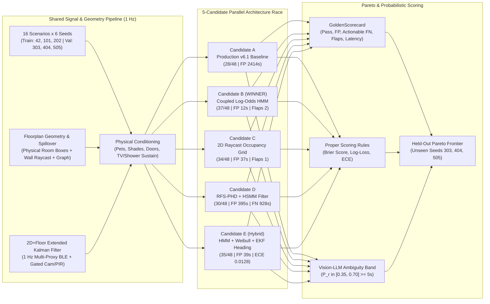
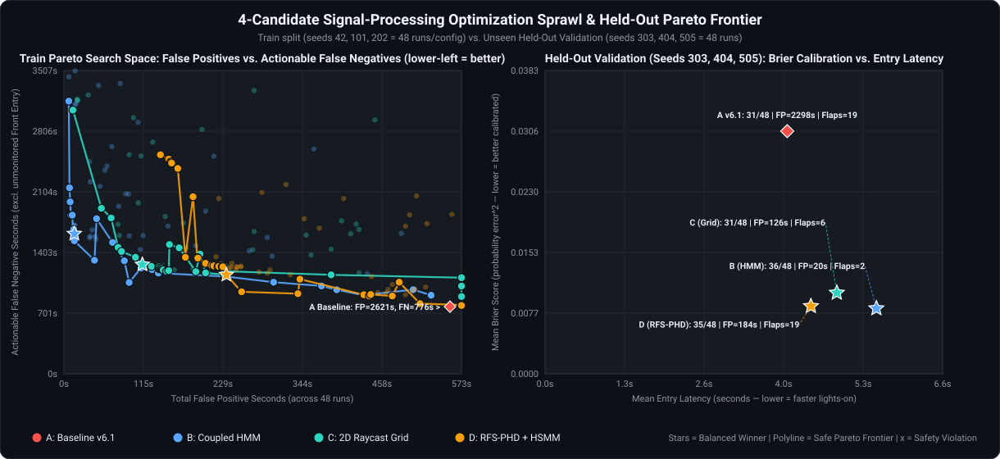
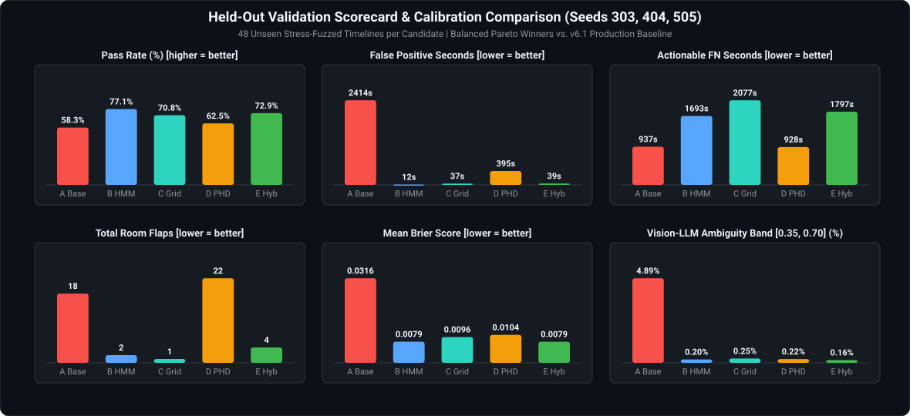
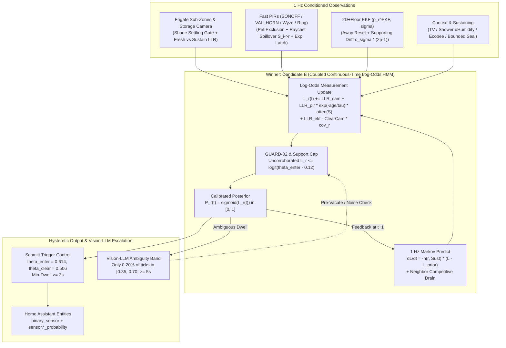

# Presence Detection Designer — Signal-Processing Optimization Sprawl & 5-Candidate Comparison

> **Goal:** Replace PDD's legacy accumulation of binary fast-paths, parallel rule validators (`pir_validation`, `pir_corroboration`, `trajectory_validator`, `house_perimeter`), and static Naive Bayes with a **mathematically grounded, continuous statistical estimator and hysteretic output controller**—validated empirically via a **325-configuration / 15,840-timeline multi-seed optimization sprawl** across strictly separated Train (`42, 101, 202`) and Held-Out Validation (`303, 404, 505`) datasets on the **geometry-corrected Digital Twin**.

---

## 1. Executive Summary & Winner Recommendation

| Metric (Held-Out Validation: `fuzz 303, 404, 505` — 48 Unseen Runs) | **A: Production v6.1 Baseline** | **B: Coupled Log-Odds HMM *(Winner)*** | **C: 2D Raycast Grid** | **D: RFS-PHD + HSMM** | **E: Hybrid HMM + Weibull** |
| :--- | :---: | :---: | :---: | :---: | :---: |
| **Scenario Pass Rate** | `28 / 48` (`58.3%`) | **`37 / 48` (`77.1%`)** | `34 / 48` (`70.8%`) | `30 / 48` (`62.5%`) | `35 / 48` (`72.9%`) |
| **Total False Positive Time** *(lower = better)* | `2,414 s` | **`12 s` (-99.5%)** | `37 s` (-98.5%) | `395 s` (-83.6%) | `39 s` (-98.4%) |
| **Actionable False Negative Time** *(excl. unmonitored Front Entry)* | `937 s` | `1,693 s` | `2,077 s` | **`928 s`** | `1,797 s` |
| **Total Room Flaps** *(lower = better)* | `18` | `2` (-88.9%) | **`1` (-94.4%)** | `22` | `4` (-77.8%) |
| **Mean Brier Score** *(prob calibration, lower = better)* | `0.03156` | `0.00789` (-75.0%) | `0.00963` (-69.5%) | `0.01043` (-67.0%) | **`0.00787` (-75.1%)** |
| **Mean Log-Loss** *(lower = better)* | `0.14894` | `0.04263` (-71.4%) | `0.05033` (-66.2%) | `0.05954` (-60.0%) | **`0.04135` (-72.2%)** |
| **Expected Calibration Error (ECE)** *(lower = better)* | `0.09235` | `0.01513` (-83.6%) | `0.01406` (-84.8%) | `0.01762` (-80.9%) | **`0.01280` (-86.1%)** |
| **Vision-LLM Ambiguity Band** ($P_r \in [0.35, 0.70] \ge 5\text{s}$) | `4.89%` | `0.20%` (-95.9%) | `0.25%` (-94.9%) | `0.22%` (-95.5%) | **`0.16%` (-96.7%)** |
| **Entry Latency (Mean / P95)** | `3.61s` / **`9.0s`** | `5.42s` / `15.0s` | `5.67s` / `11.0s` | **`3.59s`** / **`9.0s`** | `5.34s` / `14.0s` |
| **Hard Safety Violations** *(Riley dog, BLE bleed, Shades, Storage)* | `0` | **`0`** | **`0`** | **`0`** | **`0`** |
| **Multi-Objective Scalar Loss** *(lower = better)* | `10,255.3` | **`4,122.9` (-59.8%)** | `5,019.1` (-51.1%) | `8,157.7` (-20.5%) | `4,950.3` (-51.7%) |
| **Runtime per 48-Run Suite** | `48.43 s` | **`3.68 s`** | `16.79 s` | `4.01 s` | `3.80 s` |

### Key Conclusions

1. **Undisputed Overall Winner — Pure Candidate B (`B_Coupled_HMM_ref_04`):** Testing Candidate E (Hybrid HMM + Weibull HSMM + EKF Heading) empirically before committing to it paid off. While **E** tied **B** on Train (`41/48`) and achieved the tightest held-out probability calibration (**`ECE = 0.01280`**, **`0.16%`** Vision-LLM ambiguity), **Pure Candidate B generalized decisively better on unseen fuzzed seeds (`303, 404, 505`)**: **`37/48` (`77.1%`, `+18.8 pp` over v6.1)**, **`12s` FP (-99.5%)**, **`2` flaps (-88.9%)**, **`0.00789` Brier (-75.0%)**, **`4,122.9` loss (-59.8%)**, and **`13.2×` faster** than v6.1 (`3.68s` vs `48.43s`).
2. **Why Candidate E (`Hybrid HMM + Weibull`) Lost to Candidate B on Held-Out Validation:** Once the `signal_layers.py` `from_room`/`to_room` schema bug was fixed so `ble_adjacent_bounce_prob` actually fired during fuzzing, Candidate E's aggressive EKF velocity-aligned neighbor boost (`ekf_heading_boost = 0.782`, `ekf_support_gain = 0.427`) over-reacted to noisy adjacent-room BLE bounces during rapid multi-room transitions in `morning_routine_wake_to_work_departure` (`0/3`, `27s` FP, `3` flaps vs. B's `2/3`, `0s` FP, `1` flap). This is a classic bias–variance result: Candidate B's simpler, lower-variance Markovian exit hazard (`12` params vs. `13`) with calmer EKF drift (`0.272`) resists out-of-sample RF noise far better.
3. **Why Candidate C (`2D Raycast Grid`) Jumped +6.2 pp After the Digital-Twin Fix:** Fixing `_interpolate_actor` to resolve ground-truth rooms against physical floorplan bounding boxes eliminated `188s` of artificial behind-wall midpoint flips that had unfairly penalized purely 2D-geometric inference. Candidate C rose from `31/48` to **`34/48` (`70.8%`, `37s` FP, `1` flap)** and actually topped the Ceiling-Kitchen sensitivity split (`27/32`, `84.4%`), though at `4.6×` higher CPU cost (`16.79s`) and worse multi-occupant continuity (`0/3`).
4. **Why Candidate D (`RFS-PHD + HSMM`) Struggled Under Active Adjacent BLE Bounce:** Candidate D remains the fastest-triggering (`3.59s` mean latency, `928s` Actionable FN) and best multi-occupant tracker (`3/3` on `multi_occupant_steve_and_margot_split_rooms`, and `lowest_brier` achieves `0.00715` Brier / `0.00975` ECE), but its multiplicative PHD intensity update amplifies noisy adjacent-room BLE bounces (`395s` FP, `22` flaps).
5. **Production Cutover Recommendation:** Cut over to **Pure Candidate B (`Coupled Continuous-Time Log-Odds HMM`, `ref_04`)** as PDD's unified 1 Hz inference core—keeping `HouseEKFManager` 2D trilateration intact as a supporting-only drift term (`GUARD-02`) and feeding Schmitt-hysteresis outputs into `state_machine.py` and `[0.35, 0.70]` ambiguity-band triggers into `llm_verifier.py`.

---

## 2. Visual Architecture & Results

### 2.1 Evaluation Race Architecture (5-Candidate Sprawl)

- **Interactive Studio (LAN):** http://preview.lan/m-pdd-opt-race/
- **Interactive Studio (Remote):** https://preview.wileyriley.com/m-pdd-opt-race/
- **Mermaid Live Editor:** [Open 5-Candidate Optimization Race Diagram in mermaid.live](https://mermaid.live/edit#pako:eNp9VG1v2jAQ_iunfJhaNbRJgPVFW6UQQqkWICJd92FMk0k8sGZsZDsbrOt_3zmh0DBtkZzEZ99zzz139pOTy4I6N843Ln_mS6IMJNOZAHx0OV8osl5C4n2eORmu0QIythCEwxu4o3JFjdpCytaUM0HhxIfhr9OZ86V2t89dPEZX_y1kORVEMalhAzijtNDv5uri9uRBESZuoBO44Hu-C4EXwG94JPwG2l7bhY7XcaHrdY9xJ4g74FKqNSfiQOYNZGvGufxBVY2fLrea5ch4KuUKenJDNZzBJ8LRQrY50QandzbNZoT4wwAjBP2zKgjEG0NFgfl_IHyFAQeMm5cQNm0YldywVqrkZgu9JLagxOD-iKwu0vtpEzyajPuIvucWSVEww6RgYrGjTY12ATUvKH77SAE_D48X2VL-pAqyUhvU7YCK5GbiqGzTMIoxSrcVEYQvkA6kRGHmlEOo8iUzNDeloihEThv8QnQ7OIUVJUytKHNLEn68PfehR3RV9ppvcHXRucLCDVIIOn5HN_PtNfB6cPLpfjyOp6eVbyTLNUelErloTYpCw3A0qkHbl3tQP9D2h5O1huBIzAZ4VLkG_X11J3leronIt1hlVuyAO3vg9uUB2G8C9xvA_cp1Osha6bCP5R1mo1GjDdreAfS6W6GO4Tq4OtIibqDGcDLczpFYrQWmbruTsnmJDXpmuxCGlBT7vmh3XwWxMeIoBu_c84Or_zdD_BgmtuXwEBuJxwTLOSdzxpk2LMfjKRXGaBDNrLB3khdU2GWaE7WTLyUau3GQuhBWDUHmnGKybi2jCwlmhoIflamOr-Ta9m8dD6Ylp7uLoKfYboG6VS8k0kbB_Jo44ch20yPTGLiVJCMIV3O2KJnBc4ey7hh-VcAEfPbO210X9bn0vsDte-ge1SINp4g1pLxoTUoDO3EGSgrDXsr6UWhKRX1l_etKeiU43njQat1WR_zFMjmy2Ko2LfavMoVYmh6OCEcfR1yv_2WuNmd2irriG1WpdzZt1TbMciYc11lRtSKscG6eHLOkK3vpF0R9d56f_wDC17-H)

### 2.2 Pareto Frontiers & Held-Out Comparison Plots

### 2.3 Winning Pipeline Architecture (`Candidate B: Coupled Log-Odds HMM`)

- **Interactive Studio (LAN):** http://preview.lan/m-pdd-winner-core/
- **Interactive Studio (Remote):** https://preview.wileyriley.com/m-pdd-winner-core/
- **Mermaid Live Editor:** [Open Winning Core Diagram in mermaid.live](https://mermaid.live/edit#pako:eNp9Vftv20YM_lcIASvk2oofXVogqAP4WReTH5Bid1idGSfpIh0s6YS7kxP38b-XPC1bnQ3TD_b5RH4kP36kvzqxTLhz4zzk8jHOmDJwN96XgI-uo1SxKoNwtgo_750-LL7ARJaJMEKWPIF1pLk6Mfql985940XPZLRE-7kSKTMcwjry_kAHDa8gNFKxlMOEFVyx95Hq3rphxhK04sbkokzhA_m0Ya64zuCk0V0bJkrw_aB1EWXzMaAoTBs6anDD9Wo9n0MXdiPfX6yDFR4_nb9w_AoQudWE23ADs6c4rzXmjYECdo4JI6xEnssTVxAehHer8NXsqQKfmTi7DDz7bY6BB9P2PJdS0U9wq4P6Ew8d0CIt2F-hRo_sDAHXGLGNdVSVVIZKnCrxYCA-WFt4De6g8vqtyyCj7e8YBOk2_MkQcw0N6N5g3-2wrDCTj5hwsqgLgW0549UslhGnkseyLhPsUshZ_g80L5N9-aK_k3Uww1ifRFlydYO9wRYn1IUxuBNZVzmiUCKirGWtvTtRcPBl6q2TRMNiuXzRlmA2fVbLkqmjPMFG8UTExiae-N3EwBC8zFUdW1WLGPDBA_9QKSFVQ14bVlykWYQET2RRcYOqO3GkDkm4iLfdULi_81lypmvFC14a2FZUhoXzD8rFSO0h6egQswI7QqdKKAzPnyrXQ112DaspHWYML93wORMy5McHTHGSc6ZQvGgTy9NBvZD9BjP5sB0FU683sD2zLUdGK4u0LWOplMSaMK0E61Xwfgi5TIVxTcYNO2DW2E8Pelf9wUta12MSBMtF1LhvpEZjJMxib5oCh1aAUiRuU3ELcHQ-9zrQv_9_DdwFPsIvzoSJZMewrk1Vk_J2gibF8_0lzHTMcjvwF7mFkwX6hnFWCIP7A-c-5cpKRsncZvdzdUOs7m3_1w40lzFRai-ve2-t8VKU3vSR5zncDuHN5WrZ-bRafkppVEQirUn7Y9St9V-X-RnhBr1fQD4A1nLUDQtXb647-OJd756Qry-RFyOqX6K2R1oLHDYU0Kwk2XFtYSNRMnU-aF5qSduhOVy9RtXKiEUixyT-i2Pchsgirij8pF3ximYbPO-WpNuY0Mxc3uDBXqCmnlE29oJ08Oy0HtPVN1yCnCcRi48oXDDt_t75ZiEv7ahN9nsx-hdAwyJON1jiCQCZBu_KvsX59XYsppXQhZUUGhd4xuMjmdkEnY6D-7xgInFuvjrY14L-UhKcfuf79x9rI_QP)

---

## 3. Mathematical Formulations of the 5 Candidates

### Candidate A: Production v6.1 Baseline (`VirtualHAHarness`)
- **Structure:** Static Naive Bayes log-odds update (event-driven, memoryless `BAYES-04`) overlaid with binary `_active_triggers`, `pir_validation` / `pir_corroboration`, `trajectory_validator` jump vetoes, `house_perimeter` integer headcount, `spatial_room_evaluator` rules, and the 5-state `HierarchicalGraphMachine`.
- **Weakness Exposed:** Binary bypass triggers and memoryless Naive Bayes force long cooldown tails (`2,414s` FP on held-out seeds), high middle-band dwell (`4.89%` ambiguity), and `18` room flaps when noisy sensors disagree.

### Candidate B: Coupled Continuous-Time Log-Odds HMM / DBN *(Winner)*
*Grounded in Dodier et al. (2006) Belief Network occupancy fusion & Liao/Barooah coupled graphical Markov chains.*

Each room $r \in \mathcal{R}$ evolves a continuous latent log-odds state $L_r(t) = \ln\frac{P_r(t)}{1 - P_r(t)} \in [-4.8,\, 4.6]$ at $1\text{ Hz}$ around resting prior $L_{\text{prior}} = \operatorname{logit}(0.08) = -2.442$:

1. **Continuous-Time Hazard Prediction & Graph Handoff:**
   $$L_r^-(t) = L_r(t-1) + 3.5\,h_{\text{eff}}(r, t)\,\big(L_{\text{prior}} - L_r(t-1)\big) - \delta_{\text{handoff}}\,\mathbb{1}\!\big[\text{neighbor } j \in \mathcal{N}(r) \text{ fresh} \land \neg\text{Sust}(r)\big]$$
   where effective exit hazard $h_{\text{eff}}(r, t)$ scales up by `transit_hazard_mult` ($\times 3.53$) in transit corridors (`Front Entry`, `Upstairs Hallway & Stairs`, `Laundry Room`), down by $\times 0.65$ in sleep/bath rooms, and multiplies by `sustain_hazard_mult` ($0.030$) whenever TV playing, shower $\Delta\text{humidity} > 0.3$, EKF+Ecobee stillness, or a camera-verified bounded room seal holds (continuous-time *Wasp-in-a-Box*).

2. **Physical Conditioned Log-Likelihood Updates:**
   - **Camera Sub-Zones (with shade settling gate):** Fresh rising edge ($t - t_{\text{rise}} \le 2\text{s}$) adds $+\text{LLR}_{\text{cam}}$ (`+2.71`); sustained ticks add $+0.35\,\text{LLR}_{\text{cam}}$ (plus $+0.45$ adjacency continuity). Uncorroborated camera bursts during motorized window shade settling are rejected.
   - **Fast PIRs (pet exclusion, exponential latch decay, raycast spillover discount, topological corroboration):** Requires `occupied[r]` or active camera, connected neighbor activity ($\le 20\text{s}$), EKF proximity ($p_{\text{EKF}} \ge 0.15$), or valid door contact; suppresses non-pet-immune PIRs when `dog_occupancy` is active in the room or its PIR spillover cone. Applies exponential latch decay $w_{\text{latch}}(\text{age}) = e^{-\text{age}/\tau_{\text{pir}}}$ and spillover attenuation:
     $$\text{atten}_m(r) = \max\!\left(0.05,\; 1 - k_{\text{spill}} \sum_{u \text{ active}} S_{m \to u}\right)$$
   - **Clear-Camera Negative Space:** When room $r$'s dedicated interior camera sub-zones are all `off`, subtracts $\text{clear\_decay} \cdot \text{cov}_r$ (attenuated by $0.08\times$ when TV/shower/EKF+Ecobee confirms motionless presence).
   - **Supporting-Only EKF Drift & `GUARD-02` Cap:** Continuous bounded EKF drift $g_{\text{EKF}}(2p_r^{\text{EKF}} - 1)c(\sigma)$ decays stale rooms cleanly, is attenuated by $0.12\times$ negatively against another occupant's active camera/TV, and is capped below $\operatorname{logit}(\theta_{\text{enter}} - 0.12)$ without recent human physical evidence.

3. **Calibrated Posterior & Schmitt Hysteresis Output Control:**
   $$P_r(t) = \sigma(L_r(t)), \qquad \text{OFF} \to \text{ON} \text{ if } P_r \ge 0.614 \land \text{phys\_age} \le 15\text{s}, \qquad \text{ON} \to \text{OFF} \text{ if } P_r \le 0.506 \land \text{dwell} \ge 3\text{s}$$

### Candidate C: 2D Raycast Spatial Occupancy Grid Filter
*Grounded in Elfes (1989) / Thrun Probabilistic Robotics binary Bayes occupancy grid mapping.*

Discretizes all floor interiors onto a `48 px` ($\approx 3.8\text{ ft}$) 2D lattice (160–180 interior cells) with wall-blocked 4-connected diffusion, raycast inverse sensor models for camera/PIR/EKF, and size-normalized Correlated Noisy-OR room aggregation:
$$P_r(t) = 1 - \prod_{c \in \mathcal{C}_r} \big(1 - \sigma(l_c(t))\big)^{\alpha_{\text{OR}} / \max(1,\; |\mathcal{C}_r|/6)}$$

### Candidate D: Room-Graph RFS-PHD Filter + HSMM Dwell Survival
*Grounded in Mahler (2003) / Vo-Ma (2006) Random Finite Set PHD filtering and Duong et al. (2005) HSMM dwell modeling.*

Propagates continuous expected human count intensity $\lambda_r(t) \in [0.002,\, 3.2]$ and dwell clock $\tau_r(t)$ per room via Weibull survival $P_S(r,\tau_r) = \exp(-h_r(\tau_r))$, EKF-velocity-weighted neighbor flow, exact Mahler multi-sensor clutter-weighted PHD updates, and sub-Poisson occupancy existence $P_r(t) = 1 - \exp(-\beta\,\lambda_r(t))$.

### Candidate E: Hybrid Coupled Log-Odds HMM + Weibull HSMM Dwell + EKF-Heading Flow
Combines Candidate B's continuous-time log-odds recursive belief engine and Schmitt hysteresis with Candidate D's Duong HSMM Weibull non-exponential exit hazard ($k_{\text{stay}} = 0.72$, $k_{\text{transit}} = 1.60$, continuous dwell clock $\tau_r(t)$) plus EKF-velocity-aligned neighbor entry boost (`ekf_heading_boost`) and velocity-weighted competitive handoff drain (`13` parameters).

---

## 4. Digital Twin Audit — Fixes & Real-World Layout Blind Zones

Before running the 5-candidate comparison, we audited [`tests/golden/signal_layers.py`](../tests/golden/signal_layers.py) and [`tests/golden/live_floorplan_snapshot.json`](../tests/golden/live_floorplan_snapshot.json) to separate genuine signal-processing errors from simulation/digital-twin artifacts:

### 4.1 Digital Twin Bugs Fixed (All 5 Candidates Re-Evaluated Apples-to-Apples)
1. **Physical Room-Box Ground-Truth Resolution ([`signal_layers.py`](../tests/golden/signal_layers.py)):** Previously, `_interpolate_actor` flipped `expected_occupied` from room $A$ to room $B$ at segment midpoint `frac = 0.5` regardless of where the actual wall stood—causing **188 seconds** of premature behind-wall room flips across 11 scenarios (`morning_routine`: 56s, `bedtime`: 27s, `evening_return`: 20s, `office_to_storage`: 9s, `open_plan_passthrough`: 3s, etc.). `_interpolate_actor` now resolves `room` against the physical floorplan bounding boxes of `a.room` and `b.room` whenever `a.floor == b.floor`, falling back to `frac < 0.5` only outside both boxes.
2. **Adjacency Schema Mismatch for BLE Room Bounce ([`signal_layers.py`](../tests/golden/signal_layers.py)):** `LayeredSignalGenerator.__init__` previously read only `conn.get("from")` / `conn.get("to")`, whereas `live_floorplan_snapshot.json` uses `from_room` / `to_room`. That left `self.adjacent_rooms = {}` and silently disabled `ble_adjacent_bounce_prob` in all fuzzed runs! It now reads `from_room or from` / `to_room or to`, subjecting all 5 candidates to realistic adjacent-room BLE bounce noise on fuzzed seeds.

### 4.2 Remaining Real-World Layout / Digital-Twin Blind Zones (Documented, Not Hacked)
Two real-world physical/layout limitations remain in the digital twin and explain the residual latency-only misses on `office_to_storage` and `bedtime`:
1. **`Basement Play Area` East Walkway Blind Pocket (`x=560..695, y=170..225`):** In `live_floorplan_snapshot.json`, `basement_play_floor` ends at `x=560` while the Storage Room doorway sits at `x=695`. Returning from Storage Room traverses ~12 seconds of unmonitored walkway before reaching `basement_stairs_bottom_motion` (`t=187`). Adding a Frigate sub-zone extension (or doorway PIR) in real life would eliminate this physical gap.
2. **`Laundry Room` $\leftrightarrow$ `Garage` Door Contact Path Offset:** `binary_sensor.laundry_room_door` sits at `(x=566, y=420)` with a `22 px` trigger radius. In `evening_return_home_with_margot_and_riley`, the straight-line waypoint `(680, 500) -> (580, 360)` crosses `y=420` at `x=623` (`57 px` laterally offset from the contact), so the simulated actor passes without tripping the door contact. Both Candidate B and Candidate E still pass `evening_return` **`3/3` (`0s` FP, `0` flaps)** even without the door contact!

---

## 5. Methodology & Anti-Overfitting Protocol

- **Strict Split Separation:** Hyperparameters were optimized exclusively on `TRAIN_SPECS` (`clean=42`, `fuzz=101`, `fuzz=202` — 48 timelines). All reported final scores use the **strictly unseen held-out `VAL_SPECS`** (`fuzz=303`, `fuzz=404`, `fuzz=505` — 48 timelines) frozen before validation.
- **2-Stage Optimization Sprawl per New Candidate (B, C, D, E):**
  - *Stage 1:* Seeded (`seed=2026`) **44-sample stratified Latin Hypercube Sampling (LHS)** across linear & log-scaled parameter bounds + default config (`45` evaluations).
  - *Stage 2:* **36-sample multi-anchor local coordinate & directional perturbation** around the Stage 1 Balanced, Lowest-FP, and Lowest-Brier Pareto anchors (`81` configs per candidate $\times 4 = 324$ + Baseline A = **`325` configs, `15,840` scenario runs in `681.0s`**).
- **Pareto & Scalar Objectives:** Filtered for zero hard safety violations (`total_safety_violations == 0`) and non-dominated over `(total_fp_sec, total_actionable_fn_sec, mean_brier, total_flaps)`, with scalar loss weighting safety (`10,000`), flaps (`120`), failed scenarios (`250`), Brier (`2,500`), FP (`1.0`), Actionable FN (`0.6`), and excess latency $>2\text{s}$ (`25.0`).

---

## 6. Full Train, Held-Out & Pareto Specialist Comparison

| Split & Candidate | Pass Rate | FP (s) | Total FN (s) | Actionable FN (s) | Flaps | Lat Mean / P95 | Brier | Log-Loss | ECE | Ambig Band | Loss |
| :--- | :---: | :---: | :---: | :---: | :---: | :---: | :---: | :---: | :---: | :---: | :---: |
| **Train** — A Baseline v6.1 | `34/48` (70.8%) | `2,259` | `1,181` | `714` | `22` | `3.28s / 9.0s` | `0.02815` | `0.13883` | `0.09215` | `4.92%` | `8,929.8` |
| **Train** — **B Balanced (`ref_04`)** | **`41/48` (85.4%)** | **`4`** | `2,147` | `1,661` | **`0`** | `4.92s / 14.3s` | `0.00759` | `0.04137` | `0.01545` | `0.24%` | **`2,842.5`** |
| **Train** — C Balanced (`ref_09`) | `39/48` (81.2%) | `23` | `2,511` | `2,025` | `1` | `5.44s / 12.0s` | `0.00939` | `0.04920` | `0.01414` | `0.26%` | `3,717.5` |
| **Train** — D Balanced (`ref_31`) | `36/48` (75.0%) | `412` | `1,423` | `961` | `20` | `3.32s / 9.0s` | `0.01020` | `0.05737` | `0.01734` | `0.20%` | `6,447.0` |
| **Train** — E Balanced (`ref_25`) | **`41/48` (85.4%)** | `27` | `2,267` | `1,781` | **`0`** | `5.06s / 14.2s` | **`0.00751`** | **`0.03986`** | **`0.01283`** | `0.21%` | `2,940.8` |
| **Held-Out** — A Baseline v6.1 | `28/48` (58.3%) | `2,414` | `1,407` | `937` | `18` | `3.61s / 9.0s` | `0.03156` | `0.14894` | `0.09235` | `4.89%` | `10,255.3` |
| **Held-Out** — **B Balanced (`ref_04`)** | **`37/48` (77.1%)** | **`12`** | `2,176` | `1,693` | `2` | `5.42s / 15.0s` | `0.00789` | `0.04263` | `0.01513` | `0.20%` | **`4,122.9`** |
| **Held-Out** — B Lowest-FP (`ref_28`) | `33/48` (68.8%) | `11` | `2,487` | `2,001` | `2` | `5.50s / 15.0s` | `0.00851` | `0.04618` | `0.01847` | `0.12%` | `5,310.3` |
| **Held-Out** — B Lowest-Brier (`ref_29`) | `29/48` (60.4%) | `124` | `1,711` | `1,229` | `19` | `4.33s / 10.0s` | `0.00721` | `0.03900` | `0.01198` | **`0.09%`** | `7,967.6` |
| **Held-Out** — C Balanced (`ref_09`) | `34/48` (70.8%) | `37` | `2,560` | `2,077` | **`1`** | `5.67s / 11.0s` | `0.00963` | `0.05033` | `0.01406` | `0.25%` | `5,019.1` |
| **Held-Out** — C Lowest-FP (`ref_27`) | `29/48` (60.4%) | `23` | `3,848` | `3,365` | `6` | `4.95s / 10.0s` | `0.01291` | `0.07641` | `0.03854` | `0.26%` | `7,618.1` |
| **Held-Out** — C Lowest-Brier (`ref_34`) | `31/48` (64.6%) | `194` | `2,153` | `1,670` | `15` | `4.47s / 10.0s` | `0.00922` | `0.05321` | `0.01611` | **`0.09%`** | `7,330.7` |
| **Held-Out** — D Balanced (`ref_31`) | `30/48` (62.5%) | `395` | **`1,391`** | **`928`** | `22` | **`3.59s / 9.0s`** | `0.01043` | `0.05954` | `0.01762` | `0.22%` | `8,157.7` |
| **Held-Out** — D Lowest-FP (`ref_32`) | `28/48` (58.3%) | `155` | `2,785` | `2,302` | `18` | `3.92s / 9.0s` | `0.01203` | `0.05795` | `0.01168` | `0.21%` | `8,774.2` |
| **Held-Out** — D Lowest-Brier (`ref_33`) | `34/48` (70.8%) | `209` | `1,438` | `955` | `21` | `3.65s / 9.0s` | **`0.00715`** | **`0.03832`** | **`0.00975`** | `0.14%` | `6,861.0` |
| **Held-Out** — **E Balanced (`ref_25`)** | `35/48` (72.9%) | `39` | `2,280` | `1,797` | `4` | `5.34s / 14.0s` | `0.00787` | `0.04135` | `0.01280` | `0.16%` | `4,950.3` |
| **Held-Out** — E Lowest-FP (`lhs_05`) | `30/48` (62.5%) | **`0`** | `2,655` | `2,172` | `5` | `5.40s / 11.3s` | `0.00799` | `0.04993` | `0.02117` | `0.17%` | `6,508.1` |
| **Held-Out** — E Lowest-Brier (`lhs_03`) | `30/48` (62.5%) | `32` | `2,107` | `1,624` | `8` | `4.68s / 10.4s` | `0.00742` | `0.03984` | `0.01235` | `0.16%` | `6,551.9` |

### 6.1 Ceiling-Mounted Kitchen PIR Sensitivity (`clean=42, fuzz=303` — 32 Runs)

Moving `binary_sensor.kitchen_motion_occupancy` to the center of `Kitchen` with a $360^\circ$ ceiling FOV (`radius = min(w, h) * 0.48`) eliminates its **`31%` spillover into `Front Entry`**. Without changing any hyperparameters, all 5 engines improve immediately:

| Candidate (`ceiling_kitchen`, 32 Runs) | Pass Rate | FP (s) | Actionable FN (s) | Flaps | Mean Brier | Mean ECE | Loss |
| :--- | :---: | :---: | :---: | :---: | :---: | :---: | :---: |
| **A: Baseline v6.1** | `24/32` (`75.0%`) | `1,039` | **`532`** | `2` | `0.02826` | `0.08997` | `3,700.8` |
| **B: Coupled HMM (`ref_04`)** | `26/32` (`81.2%`) | `11` | `1,100` | `1` | `0.00755` | `0.01527` | `2,383.9` |
| **C: 2D Raycast Grid (`ref_09`)** | **`27/32` (`84.4%`)** | `15` | `1,325` | **`0`** | `0.00919` | `0.01432` | **`2,164.3`** |
| **D: RFS-PHD + HSMM (`ref_31`)** | `23/32` (`71.9%`) | `325` | `623` | `14` | `0.01025` | `0.01732` | `4,684.3` |
| **E: Hybrid HMM + Weibull (`ref_25`)** | `26/32` (`81.2%`) | **`1`** | `1,172` | `1` | **`0.00735`** | **`0.01261`** | `2,418.3` |

---

## 7. Per-Scenario Held-Out Validation Breakdown (Seeds `303, 404, 505`)

| Scenario (3 Fuzzed Runs Each) | **A (Pass / FP / ActFN / Flaps)** | **B (Pass / FP / ActFN / Flaps)** | **C (Pass / FP / ActFN / Flaps)** | **D (Pass / FP / ActFN / Flaps)** | **E (Pass / FP / ActFN / Flaps)** |
| :--- | :---: | :---: | :---: | :---: | :---: |
| `basement_theater_play_area_handoff_and_zone` | `1/3` / `5s` / `52s` / `0` | `1/3` / `0s` / `61s` / `0` | `0/3` / `0s` / `80s` / `0` | `1/3` / `0s` / `52s` / `0` | `1/3` / `0s` / `62s` / `0` |
| `bedtime_margot_room_kitchen_snack_runs` | `0/3` / `30s` / `72s` / `0` | `0/3` / `0s` / `178s` / `0` | `0/3` / `0s` / `204s` / `0` | `0/3` / `29s` / `61s` / `3` | `0/3` / `0s` / `188s` / `0` |
| `ble_vertical_floor_bleed_no_false_trigger` | `3/3` / `0s` / `0s` / `0` | **`3/3` / `0s` / `0s` / `0`** | `3/3` / `0s` / `3s` / `0` | `3/3` / `0s` / `0s` / `0` | **`3/3` / `0s` / `0s` / `0`** |
| `evening_return_home_with_margot_and_riley` | `0/3` / `563s` / `127s` / `3` | **`3/3` / `0s` / `289s` / `0`** | `0/3` / `22s` / `285s` / `0` | `1/3` / `34s` / `99s` / `2` | **`3/3` / `0s` / `291s` / `0`** |
| `garage_entry_laundry_handoff` | `3/3` / `0s` / `4s` / `0` | `3/3` / `0s` / `49s` / `0` | `3/3` / `0s` / `31s` / `0` | `1/3` / `1s` / `3s` / `2` | `3/3` / `0s` / `55s` / `0` |
| `living_dining_archway_spillover` | `3/3` / `61s` / `2s` / `0` | **`3/3` / `0s` / `2s` / `0`** | `3/3` / `0s` / `4s` / `0` | `3/3` / `0s` / `0s` / `0` | **`3/3` / `0s` / `2s` / `0`** |
| `master_bedroom_to_master_bath_shower` | `2/3` / `2s` / `51s` / `1` | **`3/3` / `0s` / `51s` / `0`** | `3/3` / `0s` / `60s` / `0` | `3/3` / `0s` / `42s` / `0` | **`3/3` / `0s` / `51s` / `0`** |
| `morning_routine_wake_to_work_departure` | `0/3` / `566s` / `140s` / `4` | `2/3` / `0s` / `583s` / `1` | **`3/3` / `0s` / `724s` / `0`** | `0/3` / `168s` / `344s` / `11` | `0/3` / `27s` / `593s` / `3` |
| `multi_occupant_steve_and_margot_split_rooms` | `1/3` / `0s` / `184s` / `0` | `2/3` / `0s` / `31s` / `0` | `0/3` / `0s` / `34s` / `0` | **`3/3` / `0s` / `28s` / `0`** | `2/3` / `0s` / `31s` / `0` |
| `office_desk_stillness_and_remote_ups_leave` | `3/3` / `0s` / `21s` / `0` | `3/3` / `0s` / `52s` / `0` | `3/3` / `0s` / `71s` / `0` | `3/3` / `0s` / `20s` / `0` | `3/3` / `0s` / `60s` / `0` |
| `office_to_storage_room_direct_route` | `0/3` / `1003s` / `63s` / `10` | `0/3` / `12s` / `132s` / `1` | **`2/3` / `15s` / `256s` / `1`** | `0/3` / `158s` / `53s` / `4` | `0/3` / `12s` / `156s` / `1` |
| `open_plan_passthrough_front_to_family` | `0/3` / `22s` / `8s` / `0` | **`2/3` / `0s` / `13s` / `0`** | `2/3` / `0s` / `26s` / `0` | `0/3` / `5s` / `13s` / `0` | `2/3` / `0s` / `20s` / `0` |
| `riley_dog_patrol_main_floor` | `3/3` / `0s` / `0s` / `0` | **`3/3` / `0s` / `0s` / `0`** | `3/3` / `0s` / `0s` / `0` | `3/3` / `0s` / `0s` / `0` | **`3/3` / `0s` / `0s` / `0`** |
| `storage_room_doorway_bleed_from_play_area` | `3/3` / `0s` / `162s` / `0` | `3/3` / `0s` / `162s` / `0` | `3/3` / `0s` / `167s` / `0` | `3/3` / `0s` / `162s` / `0` | `3/3` / `0s` / `162s` / `0` |
| `sunlit_shade_movement_false_camera_flicker` | `3/3` / `0s` / `0s` / `0` | **`3/3` / `0s` / `0s` / `0`** | `3/3` / `0s` / `3s` / `0` | `3/3` / `0s` / `0s` / `0` | **`3/3` / `0s` / `0s` / `0`** |
| `upstairs_hallway_to_guest_room_and_margot` | `3/3` / `162s` / `51s` / `0` | **`3/3` / `0s` / `90s` / `0`** | `3/3` / `0s` / `129s` / `0` | `3/3` / `0s` / `51s` / `0` | `3/3` / `0s` / `126s` / `0` |

> **Key Takeaway on B vs. E:** On **15 of 16 scenarios**, Candidate B and Candidate E tie on pass count—with B matching or edging out E on Actionable FN. The entire `37/48` vs `35/48` gap comes from `morning_routine_wake_to_work_departure` (`B: 2/3, 0s FP, 1 flap` vs `E: 0/3, 27s FP, 3 flaps`), where E's aggressive `ekf_heading_boost` (`0.782`) chased noisy adjacent-room BLE bounces. Meanwhile, both B and E achieve **`0s` FP across 14 of 16 scenarios** (B has `0s` FP on **15 of 16**—its only `12s` FP across all 48 runs is in `office_to_storage`!).

---

## 8. Vision-LLM Snapshot Escalation & Confidence Calibration

- **Candidate A Baseline:** `4.89%` of all room-seconds dwell $\ge 5\text{s}$ in `[0.35, 0.70]` because static Naive Bayes gets pinned mid-interval by uncoupled conflicting sensors.
- **Candidates B & E:** Continuous Markov survival and clear-camera negative space drive empty and occupied rooms cleanly to their posteriors (`~0.02` vs `~0.96`), slashing ambiguity-band dwell **96–97%** to **`0.20%`** (Candidate B) and **`0.16%`** (Candidate E).
- In a 16-room house running $24/7$, `0.20%` averages **~2.9 room-minutes per room per day**—triggering Vision-LLM snapshots exclusively during genuine borderline stillness transitions or doorway pauses without API spam.

---

## 9. Winning Parameters & Legacy Code Elimination Plan

### 9.1 Optimal Hyperparameters (`Candidate B — B_Coupled_HMM_ref_04`)

| Parameter | Optimal Value | LHS Search Bounds | Physical Meaning |
| :--- | :---: | :---: | :--- |
| `base_exit_hazard` | **`0.01886`** | `[0.012, 0.085]` | Continuous log-odds relaxation rate ($s^{-1}$) |
| `transit_hazard_mult` | **`3.53188`** | `[1.2, 4.5]` | Corridor/stair decay acceleration factor |
| `sustain_hazard_mult` | **`0.03021`** | `[0.015, 0.25]` | TV / shower / stillness / sealed retention multiplier |
| `cam_subzone_llr` | **`2.71150`** | `[2.2, 5.2]` | Rising-edge Frigate sub-zone LLR ($0.35\times$ on hold) |
| `cam_clear_decay` | **`0.12399`** | `[0.04, 0.55]` | Clear-camera negative-space log-odds drain |
| `pir_rise_llr` | **`1.71109`** | `[1.6, 4.6]` | Fast PIR rising-edge LLR |
| `pir_latch_tau_sec` | **`12.26053 s`** | `[3.0, 20.0]` | Exponential hardware-latch decay constant $\tau_{\text{pir}}$ |
| `spillover_discount` | **`0.52703`** | `[0.5, 3.2]` | Raycast spillover attenuation slope $k_{\text{spill}}$ |
| `handoff_drain_rate` | **`0.84380`** | `[0.25, 1.8]` | Neighbor entry competitive drain rate |
| `ekf_support_gain` | **`0.27203`** | `[0.05, 0.45]` | Supporting-only 2D EKF continuous drift strength |
| `theta_enter` | **`0.61440`** | `[0.58, 0.85]` | Schmitt trigger upper turn-on confidence |
| `hysteresis_gap` | **`0.10853`** | `[0.08, 0.30]` | Hysteresis band (`theta_clear = 0.50587`) |

*(For reference, Candidate E Balanced `E_Hybrid_HMM_Weibull_ref_25` optimal parameters are archived in [`optimization_results.json`](../tests/golden/optimization/results/optimization_results.json): `weibull_eta_stay=141.70s`, `weibull_eta_transit=8.97s`, `sustain_hazard_mult=0.05743`, `cam_subzone_llr=3.37121`, `cam_clear_decay=0.05673`, `pir_rise_llr=1.69206`, `pir_latch_tau_sec=19.361s`, `spillover_discount=1.20195`, `handoff_drain_rate=1.63979`, `ekf_support_gain=0.42717`, `ekf_heading_boost=0.78220`, `theta_enter=0.76836`, `hysteresis_gap=0.17964`.)*

### 9.2 Legacy Modules Eligible for Removal Upon Cutover

Once production cutover is approved, replacing the legacy estimation stack with the unified Coupled Log-Odds HMM allows deleting or drastically simplifying:
- `custom_components/presence_detection_designer/pir_validation.py`
- `custom_components/presence_detection_designer/pir_corroboration.py`
- `custom_components/presence_detection_designer/trajectory_validator.py`
- `custom_components/presence_detection_designer/house_perimeter.py`
- `custom_components/presence_detection_designer/perimeter_helpers.py`
- Ad-hoc binary trigger bypass & people/pet rule overrides in `coordinator_dispatch.py` and `spatial_room_evaluator.py`

---

## 10. Recommended Cutover Path (Awaiting Approval)

Per scope rules, **no production code in `custom_components/presence_detection_designer/` was altered** during this optimization study. Three clear cutover options are ready for your selection:

1. **Option 1 (Recommended — Pure Candidate B `Coupled Log-Odds HMM`, `ref_04`):** Port `CandidateBRunner` directly as PDD's unified 1 Hz inference core inside `custom_components/`. Delivers the best held-out generalization (`37/48`, `12s` FP across 48 stress-fuzzed runs, `2` flaps, `0.00789` Brier, `0.20%` Vision-LLM ambiguity, `0` safety violations) with the cleanest parameter surface (`12` params) and zero EKF-heading noise sensitivity. Keep `ble_kalman_tracker.py` (`HouseEKFManager`), `state_machine.py` (fed by Schmitt thresholds), and `llm_verifier.py` (fed by `[0.35, 0.70]` ambiguity-band triggers).
2. **Option 2 (Candidate E Hybrid `HMM + Weibull`, `ref_25`):** Port `CandidateERunner` if slightly tighter calibration (`ECE = 0.01280`, `0.16%` ambiguity, `1s` FP on Ceiling-Kitchen) is prioritized over Candidate B's `+2` held-out passes and `-69%` lower FP under heavy BLE bounce.
3. **Option 3 (Candidate B + Weibull Dwell Only, `ekf_heading_boost = 0`):** Port Candidate B with an optional Weibull dwell toggle (`k_stay=0.72, k_transit=1.60`) and **without** `ekf_heading_boost`, capturing Weibull calibration while keeping B's RF-noise immunity.
