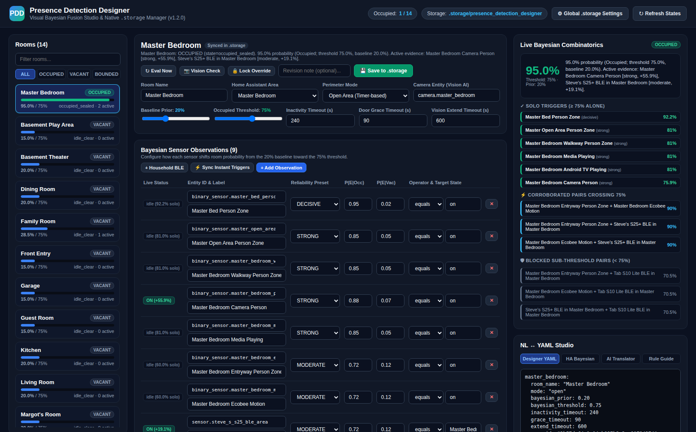
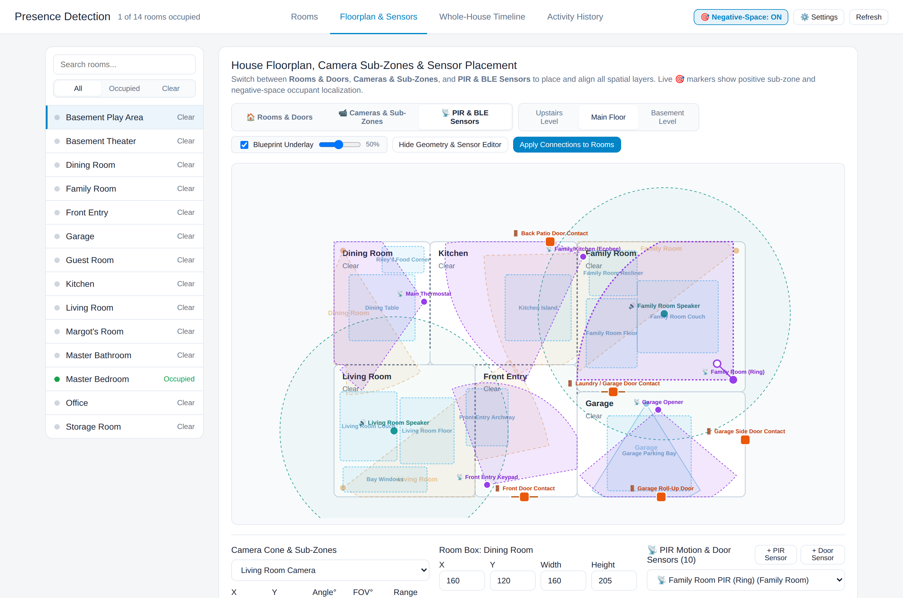
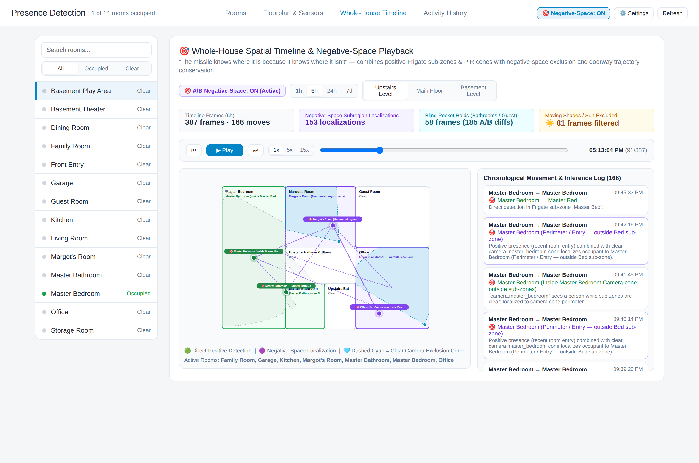

# Getting Started

This guide walks you through installing **Presence Detection Designer (PDD)**, setting up your rooms and 3D floorplan, and connecting Frigate, PIRs, Bermuda BLE, and sustaining devices.

---

## 1. Installation

### Option A: HACS (Recommended)
1. Open **HACS → Integrations** in Home Assistant.
2. Click the **⋮** menu → **Custom repositories**.
3. Add `https://github.com/spelech/ha-presence-detection-designer` with category **Integration**.
4. Search for **Presence Detection Designer**, click **Download**, and restart Home Assistant.

### Option B: Manual
Copy `custom_components/presence_detection_designer/` into your Home Assistant `<config>/custom_components/` directory and restart Home Assistant.

---

## 2. Add Rooms via Config Flow

1. Navigate to **Settings → Devices & Services → Add Integration → Presence Detection Designer**.
2. Create an entry for each room you want to track (e.g., `Office`, `Master Bedroom`, `Living Room`, `Family Room`, `Guest Room`).
3. For each room, configure:
   - **Room Mode:** `open` (open-concept / normal rooms) or `bounded` (enclosed rooms with door contacts).
   - **Primary Triggers & Sensors:** Frigate person sub-zones, fast PIR sensors (`SONOFF`, `IKEA VALLHORN`, `Ring`, `Wyze`), Ecobee occupancy/motion, and door contacts.
   - **Sustaining Conditions:** Secondary device states that indicate someone is still in the room even when sitting completely still (see Section 5).

---

## 3. Build Your Floorplan in the Studio

Open **Presence Detection** from the Home Assistant sidebar to launch the interactive Studio:

1. **Floors & Rooms:** Define your floors (e.g., `basement`, `main`, `upstairs`) and position each room polygon. Optionally upload a blueprint underlay for exact alignment.
2. **Doorways & Stairs:** Connect adjacent rooms and mark vertical transitions (stairs) so the Coupled HMM knows which rooms can physically hand off occupancy to one another.
3. **Place Physical Sensors:**
   - **Cameras & Sub-Zones:** Place each Frigate camera with its heading and FOV, and map sub-zones (e.g., `living_room_couch`, `office_desk`, `bedroom_bed`) to their exact floor coordinates.
   - **PIR Motion Sensors:** Place each PIR with its mounting position, heading, and model preset. PDD automatically raycasts the FOV against your walls to compute the **PIR Spillover Matrix** (e.g., detecting when a bedroom Vallhorn can see into the hallway).
   - **BLE Proxies:** Place your ESPHome / Google Home Bluetooth proxies on their exact floors and coordinates.

---

## 4. Sensor Preparation Best Practices

### Frigate Cameras
- **Mask stationary false positives:** Before relying on a camera sub-zone for entry lighting, verify with `?bbox=1&zones=1` snapshots that stationary objects (laundry hampers, rumpled blankets, TV reflections) aren't triggering `person` detections.
- **Per-camera thresholds:** Raise `objects.filters.person.threshold` (e.g., `0.78–0.90`) on bedroom/nursery cameras where blankets or low light can produce 60–80% false person boxes, and add targeted `objects.filters.person.mask` polygons over hampers or TVs.

### Bermuda BLE Proxies
- PDD reads live per-proxy ranges directly from Bermuda's `runtime_data` (no need to enable 1 Hz per-scanner distance entities in HA Recorder).
- Calibrate `ref_power`, `attenuation`, and per-scanner `rssi_offsets` consistently around your phone's actual TX power (e.g., `-80 dBm` if using `Medium` TX power in the HA Companion App).
- Expect vertical floor coupling (`r ≈ 0.9+`) in wood-frame multi-story homes — let PDD's **`ekf_floor_stability_v2`** handle cross-floor rejection rather than distorting Bermuda's calibration.

---

## 5. Sustaining Conditions

Sustaining conditions dramatically slow occupancy decay while you are sitting still:

| Room Type | Recommended Sustaining Condition |
| :--- | :--- |
| **Living Room / Theater** | `media_player.<tv>` `equals` `"playing"` *(as of `v0.4.2`, `media_player.*` automatically matches both `"playing"` and `"on"` so LG webOS / HDMI consoles sustain reliably)* |
| **Home Office** | `sensor.office_workstation_power` `greater_than` `90` |
| **Bathroom** | `sensor.bathroom_humidity_derivative` `greater_than` `0.3` |

---

## 6. Validate with Timeline Playback

Before connecting your lights, open the **Playback** tab in the PDD Studio to replay historical Home Assistant sensor timelines across the entire house:

Verify that:
- Walking between rooms produces clean handoffs without impossible cross-floor teleports.
- Sitting on the couch or at your desk holds occupancy without flapping.
- Hallway walk-bys don't cross `meets_lighting_threshold` in adjacent bedrooms.
