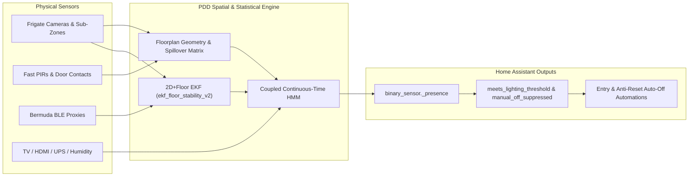

# Presence Detection Designer

**Presence Detection Designer (PDD)** is a 3D floorplan-aware, multi-modal occupancy engine for Home Assistant. Instead of relying on isolated motion timers or brittle single-sensor rules, PDD fuses **Frigate cameras**, **fast PIRs**, **slow thermal/Ecobee sensors**, **Bermuda BLE proxies**, **door contacts**, and **sustaining device states** (TVs, workstation power, shower humidity) across a coupled multi-floor house graph.

---

## What Makes PDD Different

| Problem | Traditional HA Integrations | Presence Detection Designer (`v0.4.2`) |
| :--- | :--- | :--- |
| **Sitting still (couch, desk, bed)** | PIR times out and shuts off lights | Coupled HMM + camera sub-zones + TV/HDMI/UPS sustaining conditions hold occupancy seamlessly |
| **Multi-story BLE floor bleed** | Unconstrained spherical RSSI jumps floors | 2D+Floor EKF with `ekf_floor_stability_v2` (unbiased best-proxy floor scoring + incumbent-floor camera hold) |
| **Hallway PIR spillover** | Bedroom/living room PIR trips from hallway | Raycast wall-clipped FOV spillover matrix automatically attenuates cross-room PIRs and raises lighting thresholds (`61.4% → 72% → 80%`) |
| **Manual light shutoff** | Next motion event immediately turns lights back on | Causal switch/UI detection sets `manual_off_suppressed: true` until the room clears |
| **Tuning & debugging** | Guess-and-check live in the dark | Interactive Floorplan Studio + Historical Timeline Playback + Golden Benchmark Suite |

---

## High-Level Architecture

---

## Explore the Docs

- **[Getting Started](getting-started.md)** — Install via HACS, map your floorplan, and connect Frigate, PIRs, and Bermuda.
- **[Lighting Automations](lighting-automations.md)** — Copy-pasteable Entry Lighting and Anti-Reset Auto-Off recipes with UI-tunable timeouts.
- **[How It Works](how-it-works.md)** — Plain-English walkthrough of the Coupled HMM, 2D+Floor EKF, negative space, and Playback.
- **[Configuration & Reference](reference.md)** — Complete attribute dictionary, services, feature toggles, and real-world troubleshooting.
- **[Architecture & Mathematical Reference](ARCHITECTURE_AND_MATH.md)** — Deep-dive equations and signal-processing specifications.
- **[Optimization Report](SIGNAL_PROCESSING_OPTIMIZATION_REPORT.md)** — Head-to-head benchmark across 15,000+ simulated timelines.
