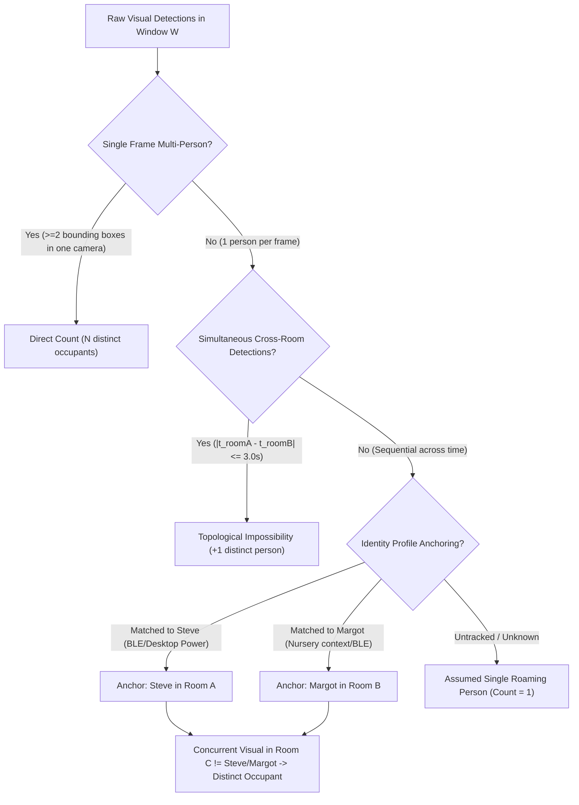

# Periodic Visual & Multi-Sensor Headcount Reconciliation Design

**Date:** 2026-11-09  
**Component:** `ha-presence-detection-designer` (`HousePerimeterTracker`, `PeriodicHeadcountAuditor`)  
**Status:** Proposed (Future Improvement)  

---

## 1. Overview & Problem Statement

The perimeter transition engine (`HousePerimeterTracker`) tracks household occupancy incrementally via edge-triggered door and gate cycles. While directional vectoring, duplicate suppression, and interior boundary exclusions (PR #21) prevent rampant inflation, incremental counter architectures inevitably suffer from **long-term drift**:

- A door cycle with simultaneous dual ingress increments by 1 instead of 2.
- A lingering departure where an occupant walks out while a door sensor fails or is propped open fails to decrement.
- Stale count safety timeouts currently require **all** rooms in the entire house to be clear simultaneously for 15 minutes (`stale_count_timeout`) before resetting to zero. If someone leaves home while another occupant remains asleep or working in the office, whole-house vacancy never occurs, and the counter remains offset indefinitely.

### Core Objective
Implement a periodic background reconciliation mechanism that audits camera visual detections and non-camera sensor states over a multi-minute observation window to safely reconcile `sensor.house_occupant_count` down (e.g. 3 $\rightarrow$ 2) or up without dropping unmonitored occupants.

---

## 2. Fundamental Constraints & Principles

1. **Conservative Reconciliation**: Headcount must only be adjusted downward when it is mathematically and physically impossible for the missing occupants to exist in any monitored or unmonitored space.
2. **Confirmed Different People**: When cameras observe individuals across time, the system must not mistake one person moving between rooms for multiple distinct occupants. Multiple people must be verified via spatial concurrency, multi-person bounding boxes, or profile anchoring.
3. **The Non-Camera Room Problem**: Rooms without cameras (e.g., Powder Bath, Master Bathroom, Guest Room, Upstairs Hallway & Stairs, Laundry Room) cannot simply be assumed empty. They must be evaluated against explicit sensor criteria (PIR stillness, sealed door states, humidity rates, and lighting/power loads).
4. **Perimeter Quiescence**: Reconciliation must never execute during or immediately following active perimeter activity (minimum 5 minutes of door quiescence).

---

## 3. Mathematical Formulation: Min/Max Headcount Envelopes

At any periodic evaluation cycle $t$ evaluated over a rolling observation window $W$ (e.g., 15 minutes):

$$\mathbf{H_{\min}(W)} \le \mathbf{H_{\text{actual}}} \le \mathbf{H_{\max}(W)}$$

### 3.1 Lower Bound ($H_{\min}$ — Proved Occupant Floor)
The minimum number of distinct individuals undeniably present in the house at time $t$.
$$H_{\min} = \max\left( N_{\text{concurrent\_visual}}, N_{\text{profile\_anchors}} \right)$$

If the live `house_occupant_count` $< H_{\min}$, the counter is undercounting. It is immediately safe to increment:
$$H \leftarrow \max(H, H_{\min})$$

### 3.2 Upper Bound ($H_{\max}$ — Physical Capacity Ceiling)
The maximum number of occupants that could physically exist given visible individuals and unobserved pockets:
$$H_{\max} = N_{\text{confirmed\_distinct\_observed}} + N_{\text{potential\_unmonitored\_pockets}}$$

Where:
- $N_{\text{confirmed\_distinct\_observed}}$: Total distinct individuals identified across all camera-monitored zones during window $W$.
- $N_{\text{potential\_unmonitored\_pockets}}$: Total number of non-camera rooms that cannot be conclusively proven empty.

If $H_{\text{current}} > H_{\max}$ continuously across $K$ consecutive audit windows (e.g., $K = 2$, representing 30 minutes of stable observation), the excess occupants $H - H_{\max}$ are phantom. The system safely reconciles:
$$H \leftarrow H_{\max}$$

---

## 4. Proving "Confirmed Different People"

To prevent counting a single roaming person as multiple occupants, the system employs three distinctness criteria:



### 4.1 Single-Frame Multi-Person Bounding Boxes
If Frigate or Vision AI detects 2+ person bounding boxes in a single camera snapshot (e.g., Living Room camera sees two people on the couch), $N_{\text{distinct}} \ge 2$ with certainty 1.0.

### 4.2 Cross-Room Simultaneous Concurrency
If Camera $A$ (Family Room) and Camera $B$ (Basement Play Area) both detect an occupant at timestamps $|t_A - t_B| \le 3.0\,\text{s}$, a single physical human cannot traverse the topological distance between floors in 3 seconds. The two detections are provably distinct individuals.

### 4.3 Identity Anchoring via Household Profiles
Using `HOUSEHOLD_PEOPLE_PROFILES` (`spatial_catalog.py`):
1. **Steve**: Anchored by personal BLE trackers (`sensor.steve_s_s25_ble_area`, Galaxy Watch) and workstation active power draw (`sensor.office_ups_used_watts_filtered > 140W`). When Steve is confirmed in the Office, any simultaneous or near-simultaneous visual detection outside the Office is guaranteed to be a distinct occupant.
2. **Margot**: Anchored by nursery/bedroom presence and primary activity windows.
3. **Guest / Untracked**: Any visual detection in an active room that occurs while tracked profile occupants are pinned elsewhere counts as a distinct, confirmed person.

---

## 5. Non-Camera Room Isolation & Pocket Auditing

Non-camera spaces are evaluated against a strict set of vacating heuristics before their pocket capacity $N_{\text{pocket}}$ is set to 0:

| Non-Camera Room | Sensor Monitored | Criteria Required for $N_{\text{pocket}} = 0$ (Confirmed Vacant) | Fallback if Ambiguous |
| :--- | :--- | :--- | :--- |
| **Powder Bath** | Door sensor, light switch | Door open with light off, OR door closed but quiet $> 15$ min with light off. | $N_{\text{pocket}} = 1$ |
| **Master Bathroom** | Wyze PIR motion, dHumidity sensor, vanity/shower lights, fan | Wyze PIR quiet $> 15$ min AND $\text{dHumidity} \le 0.3\%/\text{min}$ AND vanity/shower lights off AND fan off. | $N_{\text{pocket}} = 1$ |
| **Upstairs Hallway & Stairs** | Wyze PIR motion, hallway PIR | PIR quiet $> 5$ min AND adjacent rooms (Master Bed, Margot's Room, Office) cameras see entry clear. | $N_{\text{pocket}} = 0$ |
| **Laundry Room** | Door sensor to hallway, door to garage | Both doors closed and quiet $> 15$ min, OR hallway door open with laundry PIR clear. | $N_{\text{pocket}} = 1$ |
| **Guest Room** | Door sensor, Ecobee motion | Door open with no motion $> 30$ min, OR Ecobee occupancy clear $> 60$ min. | $N_{\text{pocket}} = 1$ |

> [!CRITICAL]
> If **any** non-camera room fails the vacancy criteria (e.g., Master Bathroom light is ON or door was closed 4 minutes ago), $N_{\text{potential\_unmonitored\_pockets}} \ge 1$. Headcount will **NOT** be reconciled downward below $N_{\text{observed}} + 1$.

---

## 6. Architecture & Execution Workflow

```
       +-----------------------------------------------------------+
       | Periodic Audit Cron (Every 15 minutes)                    |
       | (HousePerimeterTracker.async_audit_visual_headcount)      |
       +-----------------------------+-----------------------------+
                                     |
                                     v
       +-----------------------------------------------------------+
       | Step 1: Perimeter Quiescence Check                        |
       | Has any perimeter door opened/closed in the last 5 min?   |
       | - YES -> ABORT audit (Wait for steady state)              |
       | - NO  -> Proceed                                          |
       +-----------------------------+-----------------------------+
                                     |
                                     v
       +-----------------------------------------------------------+
       | Step 2: Non-Camera Room Audit                             |
       | Query bathrooms, hallways, laundry, and guest rooms.      |
       | Compute N_potential_unmonitored_pockets                   |
       +-----------------------------+-----------------------------+
                                     |
                                     v
       +-----------------------------------------------------------+
       | Step 3: Multi-Camera Coordinated Snapshot Sweep           |
       | Acquire synchronized snapshots from active room cameras.  |
       | Query Vision AI / LLM Multi-Image Inspection:             |
       | "Count distinct individuals and identify locations."      |
       | Compute N_confirmed_distinct_observed                     |
       +-----------------------------+-----------------------------+
                                     |
                                     v
       +-----------------------------------------------------------+
       | Step 4: Min/Max Bounds Comparison                         |
       | H_max = N_confirmed_distinct + N_unmonitored_pockets      |
       | H_min = max(N_concurrent_visual, N_profile_anchors)       |
       +-----------------------------+-----------------------------+
                                     |
              +----------------------+----------------------+
              |                                             |
              v                                             v
     H_current > H_max                             H_current < H_min
              |                                             |
              v                                             v
  Queue Downward Reconciliation                 Immediate Upward Adjust
  Require 2 consecutive cycles (30 min)         H_count <- H_min
  If stable: H_count <- H_max                   Dispatch Slack Alert
  Dispatch Slack Diagnostic Card
```

---

## 7. Configuration Schema & Settings

New global configuration options to be added to `PDDStore.global_settings`:

```json
{
  "headcount_reconciliation_enabled": false,
  "headcount_reconciliation_interval_min": 15,
  "headcount_reconciliation_consecutive_cycles": 2,
  "headcount_reconciliation_perimeter_quiescence_sec": 300,
  "headcount_reconciliation_non_camera_timeout_sec": 900,
  "headcount_reconciliation_notify_slack": true
}
```

---

## 8. Diagnostic Attribution & Slack Reporting

When an audit adjusts the headcount, a Slack Block Kit card is posted to `#presence-alerts` documenting the mathematical proof:

```text
=============================================================
ℹ️ House Headcount Reconciled: 3 -> 2 occupants
=============================================================
*Audit Window:* 30 minutes (2 consecutive matching cycles)
*Active Profiles:*
  • Steve: Pinned in Office (Workstation power 185W, S25 BLE)
  • Occupant 2: Visual detection in Family Room (Camera 2K)
*Non-Camera Rooms Audited:*
  • Master Bath: Quiet 42m, dHumidity 0.0%/min, lights OFF -> Clear
  • Powder Bath: Door open, lights OFF -> Clear
  • Guest Room: Quiet 3h, door open -> Clear
*Conclusion:* Zero plausible unmonitored pockets. 3rd occupant confirmed absent.
=============================================================
```

---

## 9. Implementation Roadmap

1. **Phase 1: Sensor Pocket Auditor (`spatial_room_evaluator.py`)**:
   Implement deterministic helper functions to calculate $N_{\text{potential\_unmonitored\_pockets}}$ based on bathroom humidity, door contact states, and PIR timers.
2. **Phase 2: Concurrency & Profile Evaluator (`spatial_inference.py`)**:
   Build time-windowed concurrency matrix checking whether camera detections in different rooms occurred within $\pm 3\,\text{s}$ or correspond to anchored household profiles.
3. **Phase 3: Periodic Headcount Auditor (`house_perimeter.py`)**:
   Implement `PeriodicHeadcountAuditor` invoked via coordinator tick with consecutive-cycle latching.
4. **Phase 4: Unit Test Harness (`test_house_perimeter_and_headcount.py`)**:
   Construct test scenarios verifying:
   - Reconciling 3 down to 2 when all non-camera rooms are clear and 2 distinct people are observed.
   - Refusing downward adjustment when a bathroom door was recently closed or fan is running.
   - Refusing downward adjustment when a single person walked across 3 camera zones sequentially.
