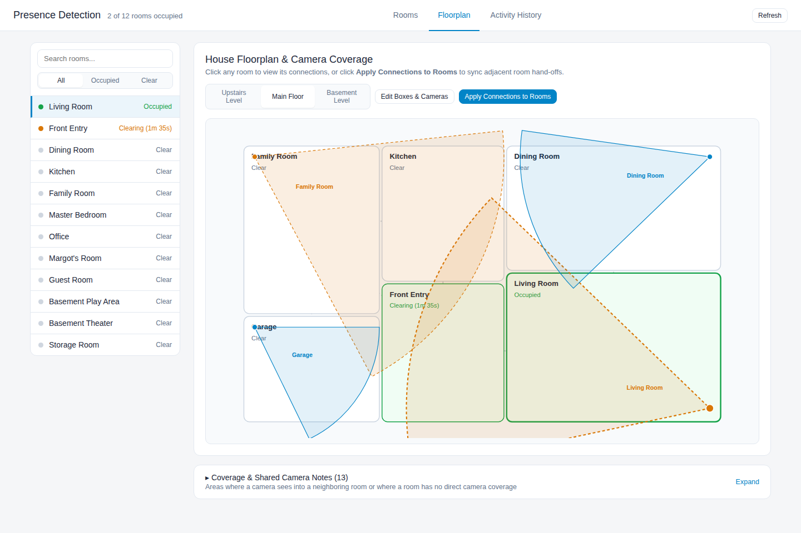
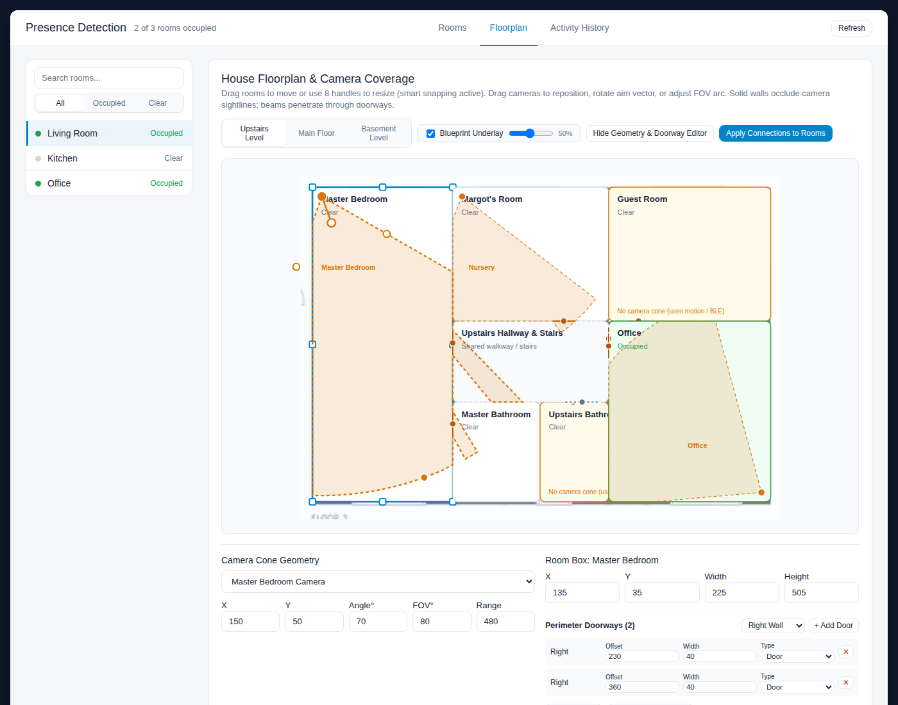
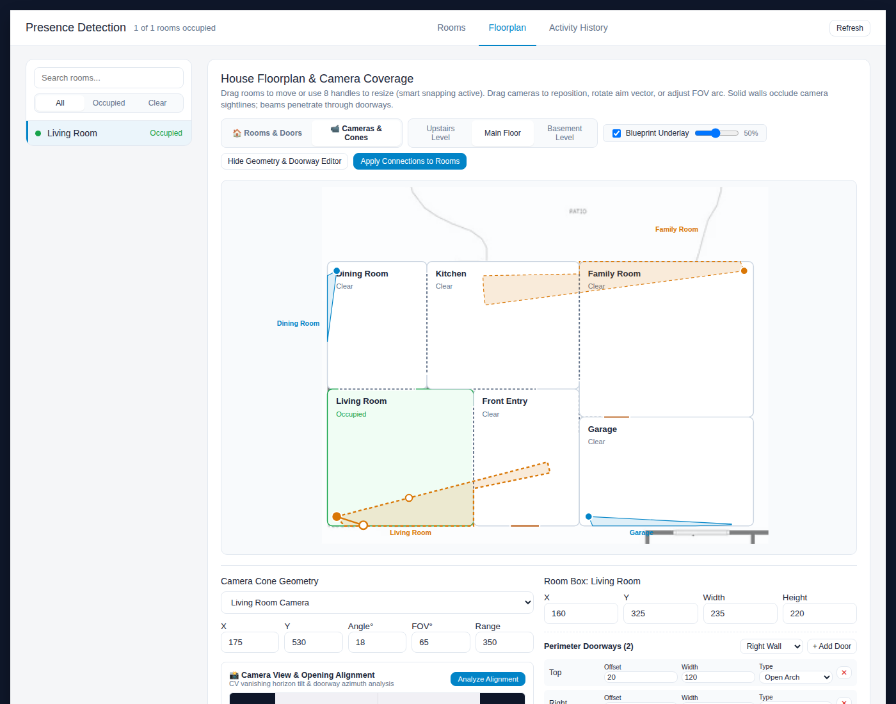
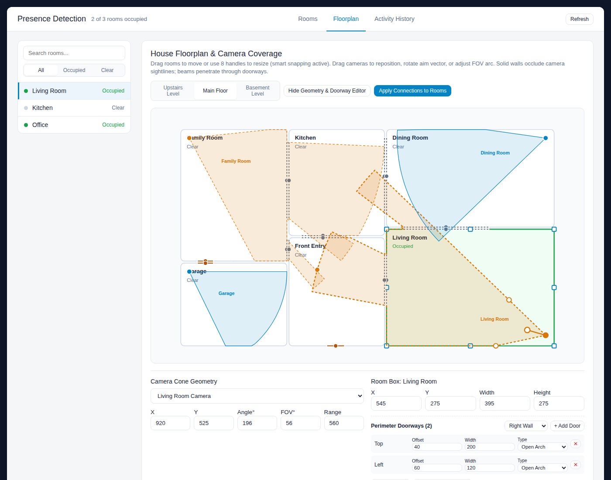
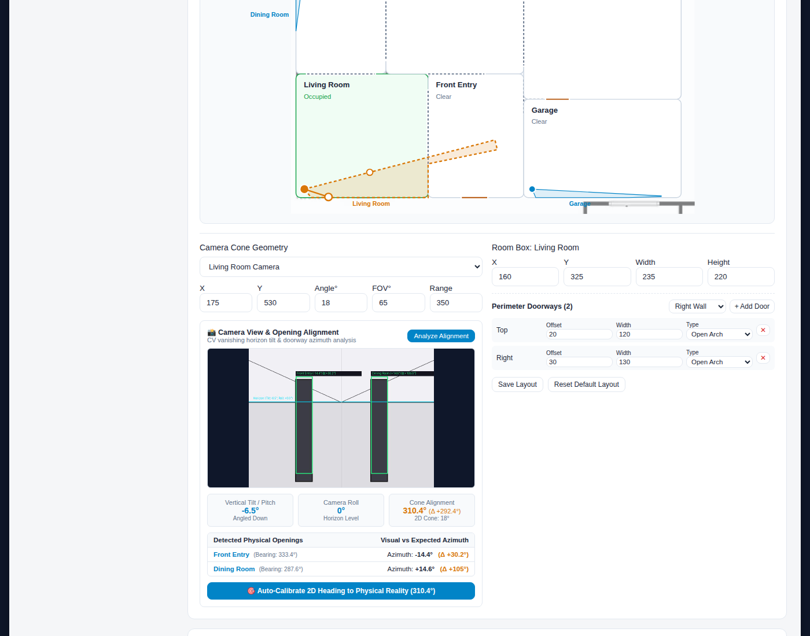

# Floorplan Studio

The **Floorplan Studio** is PDD's interactive multi-floor spatial canvas. Everything you draw here directly drives the **wall-clipped PIR spillover matrix**, **clear-camera negative-space decay**, **cross-room HMM handoffs**, and **2D+Floor EKF room integrals**.

---

## 1. Multi-Floor Canvas & Blueprint Underlay

- Switch between floors (`Basement`, `Main Floor`, `Upstairs`, or custom floors) from the floor selector bar.
- Upload or align a floorplan image / blueprint underlay so room polygons, walls, doorways, and sensor coordinates match physical reality to scale (`px_per_foot`).

---

## 2. Tool Mode Switcher & Quick-Adjust Bar

The top toolbar switches between dedicated editing modes so you never accidentally drag a room while aiming a camera cone:

| Mode | What You Can Do |
| :--- | :--- |
| **Select / Inspect** | Click any room, camera, PIR, or BLE proxy to inspect its live state, coverage percentage, and spillover links. |
| **Rooms & Doorways** | Resize/reshape room polygons, drag doorway opening tabs along shared walls, and mark stair connections between floors. |
| **Cameras & Sub-Zones** | Place Frigate cameras, adjust heading/FOV, and draw rectangular seating/bed/desk sub-zones tied to Frigate `binary_sensor.*_person_occupancy` entities. |
| **Sensors & Proxies** | Place PIR sensors (with model presets for FOV/range), door contacts, Ecobee thermal sensors, and Bermuda BLE proxies. |

When an object is selected, the **Quick-Adjust Bar** lets you nudge coordinates, heading angle, FOV, and range without opening a modal.

---

## 3. Wall-Clipped FOV Cones & Doorway Occlusion

PDD raycasts every camera and PIR cone against your room walls and doorway openings in real time:

- **Doorway Spillover:** When a PIR cone passes through an open doorway into an adjacent hallway or room, PDD computes the exact overlap percentage (`spillover_exposure_pct`) and automatically raises `recommended_lighting_threshold_pct` (`61.4%` → `72%` → `80%`) so hallway walk-bys don't trip bedroom or living room lights.
- **Visual Coverage:** PDD calculates each room's camera coverage percentage (`max_coverage_pct`) to weight clear-camera negative-space decay.

---

## 4. Camera Alignment & Live EKF Overlay

- **Camera Alignment Mode:** Compare live camera snapshots against your drawn floorplan cones to verify heading and field-of-view accuracy.

- **Live EKF Overlay:** While viewing a floor, PDD renders each tracked BLE device's 2D EKF position, $1\sigma$/$2\sigma$ uncertainty ellipse, velocity heading vector, and per-room probability breakdown.
