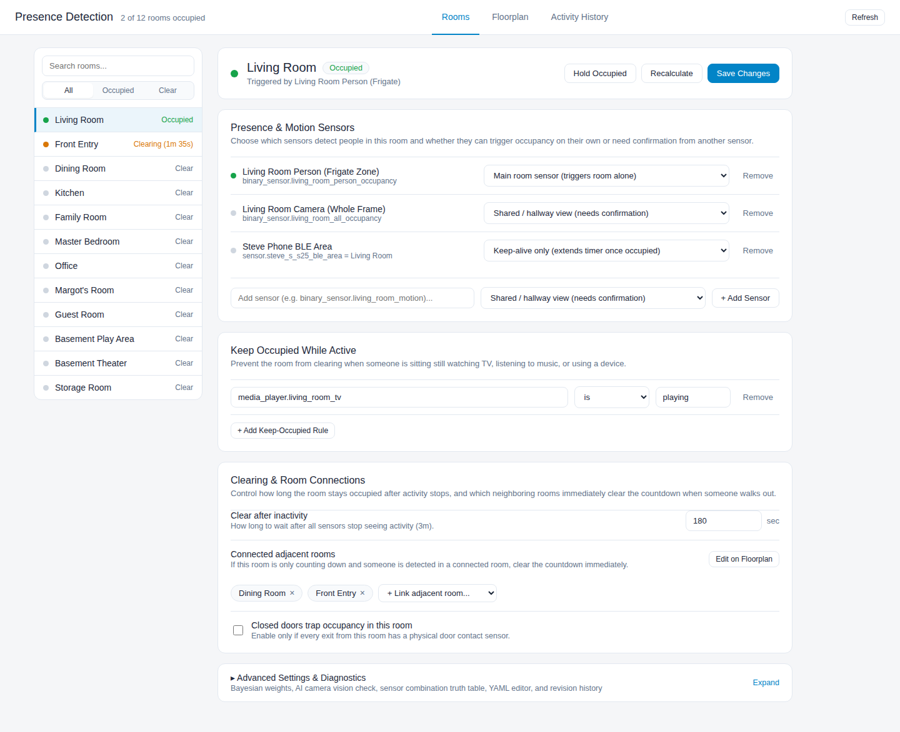
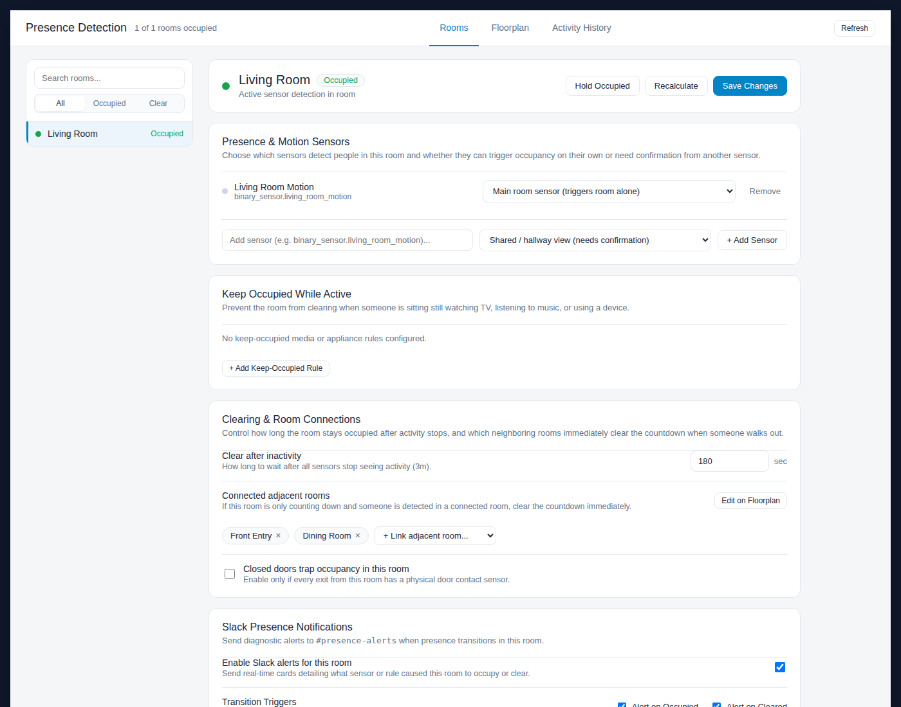
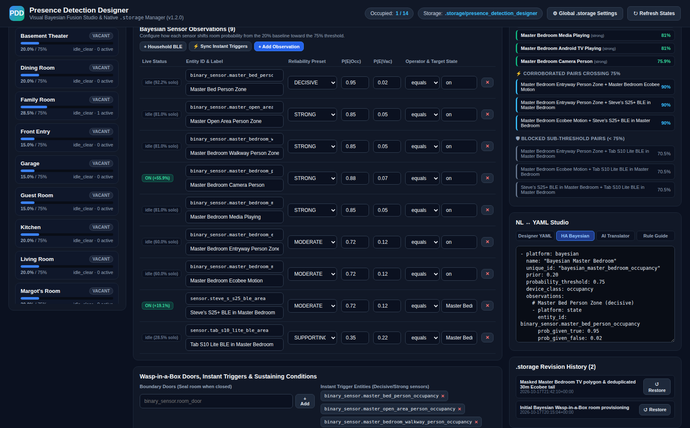
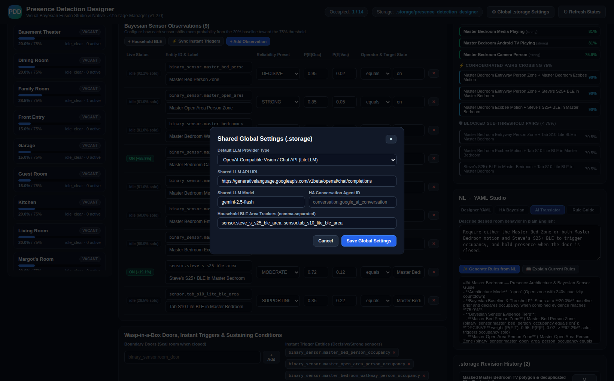

# Room Editor

The **Room Editor** is the primary per-room workspace in Presence Detection Designer. Select any room from the left sidebar to configure its sensors, sustaining rules, state machine, and diagnostics across four focused tabs.

---

## 1. Setup Tab

Configure the room's core identity, physical boundaries, and hardware bindings:

- **Room Mode:**
  - **`open`**: Standard rooms and open-concept zones where occupants can enter or exit freely.
  - **`bounded`**: Enclosed rooms with door contact sensors (e.g., bathrooms, bedrooms) that seal presence inside while the door is closed.
- **Home Assistant Area:** Links the room to its HA Area for entity discovery and light/actuator monitoring (used by `manual_off_suppressed`).
- **Primary Camera & Vision Guard:** Select the room's camera entity if you want on-demand or pre-vacate Vision LLM snapshot checks.
- **Sustaining Conditions:** Add secondary device conditions (TV `media_player`, workstation power draw, shower humidity derivative) that hold occupancy while you are stationary.
- **Per-Room Notifications:** Override Slack alert verbosity or toggle occupied/cleared notifications for this specific room.

---

## 2. Rules & Sensors Tab (NL ↔ YAML Studio)

Define which sensors vote on the room's occupancy and inspect how their combinations behave:

- **Triggers & Observations:** Add Frigate person sub-zones, fast PIRs, Ecobee occupancy sensors, door contacts, and BLE trackers with intuitive weight presets (`decisive`, `strong`, `moderate`, `supporting`).
- **Combinatorics Matrix:** Preview the exact resulting posterior probability for every combination of active sensors before saving.

- **Natural Language ↔ YAML Studio:** Describe your desired room logic in plain English and translate it into structured PDD configuration (or translate an existing config back into a plain-English summary).

---

## 3. State Machine Tab

Inspect the room's live hierarchical occupancy state machine in real time:

- **Live State & Confidence:** Displays the current state (`vacant`, `occupied_confirmed`, `occupied_holding`, `occupied_cooling`, `verifying`), live probability (`0–100%`), confidence tier, and active evidence drivers (`cam:...`, `pir:...`, `sustain:...`, `ekf:...`).
- **Transition History:** Shows the chronological audit trail of accepted and rejected state transitions with exact timestamps and reasons.
- **Manual Controls:** Trigger **Verify Presence** (immediate Vision LLM snapshot), **Force Refresh**, or toggle **Presence Override** directly from the room view.

---

## 4. Diagnostics Tab *(Advanced Mode)*

When **Advanced Mode** (`ui_advanced_mode`) is enabled in [Global Settings](global-settings.md), the **Diagnostics** tab exposes low-level telemetry:

- Raw HMM log-odds (`hmm_log_odds`), entry/clear thresholds (`theta_enter_pct`, `theta_clear_pct`), and spillover-adjusted lighting threshold (`recommended_lighting_threshold_pct`).
- Live EKF track telemetry (`floor`, `top_room`, `sigma_x_ft`, `sigma_y_ft`, `active_proxy_count`).
- Full JSON/YAML configuration export for debugging or backup.
